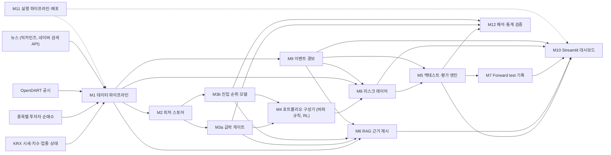

# AutoAdvisor: 개인 투자자 종목 진입 판단 보조 시스템

국내 주식을 직접 매매하는 개인 투자자가 종목에 진입하기 전에, 향후 20거래일의 급락 위험과 지수 대비 초과수익 순위를 근거(공시·뉴스)와 함께 Streamlit 대시보드로 제공하는 정보제공형 의사결정 보조 시스템.

(명세서 1.1절)

> 본 정보는 정보 제공 목적이며 특정 종목의 매수·매도를 권유하지 않습니다. 투자 판단과 그 결과의 책임은 투자자 본인에게 있습니다.

(명세서 2.3절)

## 기준 문서

이 README는 요약이며, 기준 문서는 [docs/프로젝트_구조_및_역할분담_v0.3.md](docs/프로젝트_구조_및_역할분담_v0.3.md) 다. 내용이 다르면 명세서를 따른다.

명세서 안에서 내용이 충돌하면 부록 1(사전등록 설정) > 4장(데이터 규약과 타이밍) > 6장(모듈 명세) > 7장(성공 기준) > 부록 2(작업 패키지) > 나머지 설명 순서로 우선한다. (명세서 0.1절)

## 목차

1. [프로젝트 개요](#프로젝트-개요)
2. [시스템 구조](#시스템-구조)
3. [저장소 구조](#저장소-구조)
4. [역할과 담당](#역할과-담당)
5. [공통 규칙](#공통-규칙)
6. [협업 방법](#협업-방법)
7. [AI 활용 방법](#ai-활용-방법)
8. [일정](#일정)
9. [설치와 실행](#설치와-실행)
10. [기밀 정보](#기밀-정보)

---

## 프로젝트 개요

한국 시장에서는 단기 모멘텀의 근거가 약하고, 개인 투자자가 최근 급등 종목을 추격 매수하다 손실을 보는 구조가 확인된다. 그래서 이 프로젝트의 핵심 기여는 '사면 안 되는 종목 걸러내기'(급락 게이트)이고, '지수를 이기는 종목 고르기'(진입 순위)는 도전 목표로 둔다. 모든 포트폴리오는 종목·업종 한도와 시장 노출 조절로 이루어진 리스크 레이어(M8)를 거친다. (명세서 1.2절)

### 검증할 주장

| 번호 | 주장 | 성격 | KPI |
|---|---|---|---|
| 주장 1 | 급락 게이트를 적용하면 개인의 전형적인 매수 행동에서 손실 꼬리가 줄어든다 | 핵심 | G1, G2 |
| 주장 2 | 진입 순위 모델로 고른 long-only 포트폴리오가 비용 차감 후 코스피 200을 이긴다 | 도전 | G3, G4 |
| 주장 3 | 비용을 인식하는 RL 정책이 같은 신호를 쓰는 버퍼 규칙보다 순성과가 높다 | RL 기여 | G5 |
| 주장 4 | 1·5거래일 예측은 비용을 반영하면 성과가 무너진다 | 검증 | G6 |
| 주장 5 | 리스크 레이어는 수익을 크게 해치지 않으면서 최대 낙폭을 줄이고, 한도를 한 번도 어기지 않는다 | 방어 | G0, G7 |

(명세서 1.3절, KPI 정의는 명세서 7장)

### 산출물

| 산출물 | 내용 | 주기 | 파일 | 대시보드 페이지 |
|---|---|---|---|---|
| 진입 금지 경보 | crash_flag = 1인 종목과 급락 확률 | 매주 신호일 | `signals/{t}.parquet` | 이번 주 신호 |
| 진입 후보 순위 | crash_flag = 0이고 M9 쿨다운이 아닌 종목을 rank 오름차순으로 20개 | 매주 신호일 | `signals/{t}.parquet` | 이번 주 신호 |
| 모델 포트폴리오 | M8 적용 후 목표 비중, 현금 비중, 노출 상한 E_t, 모멘텀 붕괴 국면 여부 | 매주 신호일 | `positions/{t}.parquet` | 이번 주 신호 |
| 근거 요약 | 경보, 후보, 주중 경보 종목별 공시·뉴스 근거와 출처 | 매주 신호일 | `evidence/{t}.jsonl` | 근거 |
| 주중 경보 | M9 트리거가 발생한 보유·후보 종목 | 매 거래일 | `alerts/{d}.parquet` | 주중 경보 |
| 성과·KPI | 확정된 실험 결과 | 결과 확정 시 | `reports/final/` | 성과 |
| forward test 기록 | 신호 커밋 해시와 사후 성과 | 매주 | `forward_log.csv` | forward test |

(명세서 2.2절)

---

## 시스템 구조



| 모듈 | 이름 | 역할 | 담당 | 명세 |
|---|---|---|---|---|
| M1 | 데이터 파이프라인 | 시세, 지수, 종목 정보, 업종, 상태, 수급, 공시, 뉴스를 시점별로 수집·정제 | A (가격·시장 데이터), PM (공시·뉴스) | 6.1절 |
| M2 | 피처 스토어 | 신호일별 종목 피처 행렬 | A (가격·수급·제도·시장 피처), PM (이벤트·뉴스 피처) | 6.2절 |
| M3a | 급락 게이트 | 향후 20거래일 급락 확률과 플래그 | A | 6.3절 |
| M3b | 진입 순위 모델 | 향후 20거래일 초과수익 순위 | A | 6.4절 |
| M4 | 포트폴리오 구성기 | 버퍼 규칙과 RL 정책으로 원시 목표 비중 생성 | B | 6.5절 |
| M5 | 백테스트·평가 엔진 | 라벨, 체결, 비용, NAV, 모든 지표 계산, 홀드아웃 가드 | C | 6.6절 |
| M6 | RAG 근거 제시 | 신호별 공시·뉴스 근거 요약과 출처 | PM | 6.7절 |
| M7 | Forward test 기록 | 매주 신호를 커밋해 시점을 증명하고 사후 성과 기록 | D (사후 성과 계산 함수는 C) | 6.8절 |
| M8 | 리스크 레이어 | 필터(위험 태그 적용), 종목·업종 한도, 시장 노출 조절, 모멘텀 붕괴 국면 대응 | B | 6.9절 |
| M9 | 이벤트 경보 | 매 거래일 공시를 감시해 경보(위험 태그)와 청산 신호 발생 | PM | 6.10절 |
| M10 | Streamlit 대시보드 | 산출물 파일을 읽어 보여주는 화면 | D | 6.11절 |
| M11 | 실행 파이프라인·배포 | 주간·일간 실행기, 모듈 간 입출력(`io.py`), 실행 환경, 배포 | D | 6.12절 |
| M12 | 해석·통계 검증 | SHAP 해석, ANOVA 보조 분석 | C | 6.13절 |

(명세서 5.1절)

---

## 저장소 구조

```
project/
├── configs/
│   └── prereg.yaml        # 부록 1. 2026-11-09 커밋 후 수정 금지 (R-02)
├── data/
│   ├── raw/{수집일}/      # 원천 응답 그대로, 덮어쓰기 금지
│   └── processed/         # 9.3절 스키마의 정제 테이블과 labels.parquet
├── src/
│   ├── common/            # io.py(D), guards.py(C), 거래일 캘린더(A), 체결 규칙(C)
│   ├── data/              # M1 (A: 가격·시장, PM: 공시·뉴스)
│   ├── features/          # M2 (A, PM)
│   ├── models/            # M3a, M3b (A)
│   ├── portfolio/         # M4 버퍼 규칙·RL, M8 리스크 레이어 (B)
│   ├── backtest/          # M5 라벨·NAV·비용·지표 (C)
│   ├── analysis/          # M12 SHAP·ANOVA (C)
│   ├── events/            # M9 (PM)
│   ├── rag/               # M6 (PM)
│   └── pipeline/          # M11 run_weekly, run_daily_alerts (D)
├── app/                   # M10 Streamlit 대시보드 (D)
│   ├── Home.py
│   └── pages/
├── features/              # 신호일별 피처 행렬
├── signals/               # 신호 (forward test는 날짜별 파일, 백테스트는 wf_ 파일)
├── positions/             # M8 적용 후 목표 비중
├── alerts/                # M9 경보
├── evidence/              # M6 근거 요약
├── reports/{run_id}/      # 실험별 결과 (실패한 실험 포함)
├── reports/final/         # C가 확정한 최종 결과 (대시보드가 읽는 유일한 성과 폴더)
├── _stub/                 # 스텁 출력 (커밋·대시보드 대상 아님)
├── logs/                  # 실행 로그
├── forward_log.csv        # M7 기록
├── .env.example           # 환경 변수 이름만 (값 없음, R-16)
├── .gitignore             # .env, .streamlit/secrets.toml, data/raw/ 포함
└── docs/
    ├── status.md          # 작업 진행 현황 (부록 4)
    ├── preregistration.md # 사전등록 커밋 해시와 날짜
    ├── deviation_log.md   # 사전등록 이후 변경 기록 (R-02)
    └── decisions.md       # [결정 필요] 처리 기록 (0.3절)
```

(명세서 5.3절)

### 폴더별 소유자

| 경로 | 소유 | 비고 |
|---|---|---|
| `configs/prereg.yaml` | PM | 사전등록 설정. 2026-11-09 커밋 후 수정 금지 (R-02, 작업 PM-07) |
| `data/raw/`, `data/processed/` | A, PM | 가격·시장 데이터는 A, 공시·뉴스는 PM. `labels.parquet`는 C |
| `src/common/` | D, C, A | `io.py`는 D, `guards.py`와 체결 규칙은 C, 거래일 캘린더는 A |
| `src/data/`, `src/features/` | A, PM | M1, M2 |
| `src/models/` | A | M3a, M3b |
| `src/portfolio/` | B | M4, M8 |
| `src/backtest/`, `src/analysis/` | C | M5, M12 |
| `src/events/`, `src/rag/` | PM | M9, M6 |
| `src/pipeline/`, `app/` | D | M11, M10 |
| `features/` | A, PM | 피처 행렬 |
| `signals/` | A | 신호 |
| `positions/` | B | M8 적용 후 목표 비중 |
| `alerts/`, `evidence/` | PM | M9 경보, M6 근거 요약 |
| `reports/{run_id}/` | 전원 | 실험별 결과 |
| `reports/final/` | C | 대시보드가 읽는 유일한 성과 폴더 |
| `forward_log.csv` | D | M7 기록 |
| `docs/` | PM | `status.md`는 각자 자기 작업 행만 갱신 (9.4절) |

(명세서 5.3절, 9.3절)

---

## 역할과 담당

| 역할 ID | 담당자 | 담당 | 책임 KPI |
|---|---|---|---|
| PM | 장지원 | 프로젝트 관리, 사전등록 문서, 기밀 정보, 홀드아웃 개봉 승인, M1 공시·뉴스 수집, M2 이벤트·뉴스 피처, M6, M9, 부록 3 조사 일부 | M9 매칭 정확도, RAG 평가, 공시·뉴스 피처 기여도 |
| A | 김윤하 | M1 가격·시장 데이터, 데이터 품질, M2 가격·수급·제도·시장 피처, 베이스라인 전략, M3a, M3b | G1, G3, G4 |
| B | 조윤상 | M4(버퍼 규칙, RL 환경·보상·PPO), M8(비중 산출, 위험 태그 적용, 한도, 노출 조절) | G0, G5, G7 |
| C | 손석범 | 라벨, 홀드아웃 가드, M5, M12, 홀드아웃 평가, 결과 보고서 | G2, G6, 모든 KPI 계산 |
| D | 임소현 | M7 운영, M10 Streamlit 대시보드, M11 실행 파이프라인·`io.py`·배포 | 없음 (대시보드·배포 완료 기준) |

(명세서 9.1절)

---

## 공통 규칙

모든 역할과 모든 작업에 적용한다. 리뷰와 보고에서는 규칙 ID로 지칭한다.

| ID | 규칙 |
|---|---|
| R-01 | 수치, 임계값, 날짜는 부록 1의 값만 쓴다. 부록 1과 본문이 다르면 부록 1을 따르고 불일치를 보고한다 |
| R-02 | 부록 1의 값을 바꾸지 않는다. 변경이 필요하면 제안만 하고, 사람이 승인한 경우에만 `docs/deviation_log.md`에 날짜, 사유, 변경 전후 값, 영향을 기록한 뒤 반영한다 |
| R-03 | 신호일 t의 모든 계산(피처, 필터, 노출 조절)에는 4.2절에서 허용한 정보만 쓴다. t+1일 이후의 가격, 공시, 뉴스, 수급은 라벨 계산과 성과 평가에만 쓴다 |
| R-04 | 학습, 튜닝, 체크포인트 선택에는 신호일이 2025-12-31 이하인 데이터만 쓰고 4.7절의 purge를 적용한다. 신호일이 2026-01-01~2026-10-31인 라벨과 성과는 2026-12-11 전에 계산하지 않는다 |
| R-05 | 모든 성과 지표는 M5의 함수로만 계산한다. 다른 코드로 계산한 수치는 보고서와 대시보드에 쓰지 않는다 |
| R-06 | 버퍼 규칙과 RL 포트폴리오는 M8(리스크 레이어)을 통과한 비중으로만 체결한다. 예외는 G2의 개인 행동 프록시, G6의 기간 비교, G7의 'M8·M9 미적용' 비교 실행, G4의 '노출 조절 제외' 진단 실행뿐이다 |
| R-07 | 종목코드, 날짜, 시각, 단위는 0.4절 표기 규약을 따른다 |
| R-08 | 존재를 확인하지 않은 API, 함수, 데이터 필드, 데이터셋을 가정하지 않는다. 부록 3에서 확인 결과가 비어 있는 항목이나 부록 1에서 `FILL_`로 시작하는 값에 의존하는 실제 실행·판정은 멈추고 보고한다. 구현 작업에서는 그런 값을 함수 인자나 설정값으로 받게 만들고, 단위 테스트에만 임의의 값을 쓴다 |
| R-09 | 문서에 정의되지 않은 결정은 임의로 정하지 않고 0.3절 형식으로 보고한다 |
| R-10 | 모든 실험은 설정 파일과 시드만으로 재현할 수 있어야 하며, `reports/{run_id}/`에 설정 사본, git 커밋 해시, 지표 JSON을 저장한다 |
| R-11 | KPI 미달, 실패한 실험, 버그로 인한 재실행을 숨기지 않는다. 실패한 실험의 결과도 지우지 않는다 |
| R-12 | 사용자에게 보이는 출력(신호, 경보, 근거 요약, 대시보드)에는 매수·매도를 권유하는 표현을 쓰지 않고 2.3절의 고지 문구를 넣는다 |
| R-13 | 재무제표 피처, 해외 데이터, 장중(분·틱) 데이터, NXT·애프터마켓 데이터는 쓰지 않는다 |
| R-14 | 13장 용어와 부록 1·9.3절의 변수명, 파일명을 그대로 쓴다. 같은 대상에 새 이름을 만들지 않는다 |
| R-15 | 표본 외 결과(walk-forward 테스트 연도)를 본 뒤 바꾼 설계는 '탐색' 결과로만 보고한다. KPI 판정에는 사전등록 시점의 설계를 쓴다 |
| R-16 | API 키, 토큰, 계정 정보를 코드, 문서, 커밋, 로그, AI 대화에 쓰지 않는다. 코드는 환경 변수 이름(`OPENDART_API_KEY`, `NAVER_CLIENT_ID`, `NAVER_CLIENT_SECRET`)으로만 참조한다. 실제 값은 PM이 관리하며, AI는 키 값을 요구하거나 출력하지 않는다 |
| R-17 | 선언된 역할의 작업 패키지 밖의 작업은 하지 않는다. 다른 역할의 산출물이 필요하면 9.3절 스키마를 따르는 스텁으로 대신하고(6.12절), 그 담당자에게 넘길 요청을 보고에 적는다. 다른 역할이 소유한 파일은 그 담당자의 승인 없이 고치지 않는다 |
| R-18 | 9.3절의 파일은 `src/common/io.py`의 함수로만 읽고 쓴다 (스키마 검증, 6.12절) |

(명세서 0.2절)

### 표기 규약

| 항목 | 규약 |
|---|---|
| 종목코드 | 6자리 문자열 (`"005930"`). 정수로 변환하지 않는다 (앞자리 0 손실 방지) |
| 날짜 | `YYYY-MM-DD`. 모든 날짜는 KRX 거래일 기준 한국 날짜 |
| 시각 | 한국 표준시(KST), ISO 8601 형식 (`2026-11-06T15:30:00+09:00`) |
| 금액 | 원(KRW), 정수 |
| 비율·수익률 | 소수로 저장한다 (0.15 = 15%). 본문의 '%p'는 소수의 차이다 (3%p = 0.03) |
| 수익률 종류 | 단순수익률. 로그수익률은 변동성 계산에만 쓴다 |
| 가격 | KRX 정규장 수정종가(`close`). 원시 종가(`close_raw`)는 동전주 판정에만 쓴다 |
| 거래일 표기 | 'n거래일'은 KRX 개장일 기준이다. t−k, t+k는 t로부터 k번째 이전·이후 거래일이다 |
| 연율화 | 일간 252, 주간 52 |
| 현금 | 이자 0%로 가정한다 |
| 정밀도 | 계산과 저장은 float64, 보고는 소수 넷째 자리 |
| 수식 기호 | 본문과 수식 블록의 '−', '×', '÷', '≥', '≤', '√'는 수학 기호다. 코드로 옮길 때는 ASCII 연산자와 함수로 바꾼다 |

(명세서 0.4절)

---

## 협업 방법

### 협업 규칙

| 항목 | 규칙 |
|---|---|
| 주간 회의 | PM이 매주 월요일 30분 진행한다. 지난주 산출물, 이번 주 작업 ID, 막힌 점과 [결정 필요] 항목을 공유한다 |
| 진행 현황 | 각자 자기 작업 행만 `docs/status.md`에 갱신한다. AI의 종료 보고에 나온 갱신 행을 그대로 붙여 넣어도 된다. PM은 월요일 회의 전에 확인한다 |
| 재현성 | R-10을 따른다 |
| 데이터 보관 | 원천 데이터는 수집 날짜별 스냅샷으로 보관한다 (재수집으로 값이 바뀌는 문제 방지) |
| 기밀 정보 | R-16을 따른다. 키 공유는 PM이 정한 방법으로만 하고, 유출이 의심되면 즉시 PM에게 알린다 |
| 병합 | 9.2절 리뷰어 승인 후 병합한다 |
| 완료 정의 | 코드, 설정, 결과 리포트, 해당 작업 완료 기준의 통과 기록, 리뷰 승인이 모두 있어야 완료다 |
| 결과 보존 | R-11을 따른다 |

(명세서 9.4절)

### 교차 리뷰

코드는 지정된 리뷰어의 승인 후에만 병합한다.

| 리뷰 대상 | 리뷰어 | 중점 점검 |
|---|---|---|
| A (데이터, 피처, M3a·M3b) | C | 6.2절 누수 테스트, 튜닝에 테스트 구간을 쓰지 않았는지 (R-04) |
| B (M4, M8) | A | 신호 사용 방식, 학습 구간 밖 데이터 사용 여부, M8 불변식, 시드별 편차 |
| C (라벨, M5, M12) | B | 체결·비용 규칙이 RL 환경과 같은지, 라벨 정의, 지표 함수 |
| PM (공시, 뉴스, M6, M9) | C | 문서 시각 컷오프, 신호 시각 이후 정보 혼입 |
| D (M7, M10, M11) | PM | 고지 문구, 기밀 정보 처리 (R-16), 대시보드의 외부 호출 금지 |

(명세서 9.2절)

### 모호할 때의 처리

문서만으로 결정할 수 없으면 임의로 정하지 않고 아래 형식으로 보고한 뒤 사람의 결정을 기다린다. 사람이 결정하면 PM이 `docs/decisions.md`에 날짜, 결정자, 내용을 기록한다.

```text
[결정 필요]
상황: 무엇을 하다가 어디서 막혔는지
관련 조항: 절 번호, 작업 ID, 규칙 ID
선택지: A) …  B) …  C) …
추천: 선택지 하나와 그 이유
영향: 바뀌는 파일, 지표, 일정, 다른 역할
```

(명세서 0.3절)

### 브랜치와 PR 절차

> **팀 결정 필요.** 브랜치 이름 규칙과 PR 절차는 명세서에 정해져 있지 않다. 팀이 정하면 PM이 `docs/decisions.md`에 기록하고 이 절을 갱신한다.

---

## AI 활용 방법

AI에게 명세서 파일을 첨부하고 자기 역할을 밝히면, AI가 명세서 0.5절 절차대로 그 역할의 다음 작업을 찾아 수행한다. 저장소에 접근하는 AI라면 `docs/status.md`도 함께 읽게 한다.

### 시작 문장

```text
나는 B 파트 담당이야.
나는 B 파트 담당이야. B-04 해줘.
나는 B 파트 담당이야. B-01, B-02는 끝났어. 다음 작업 해줘.
나는 B 파트 담당이야. 오늘은 2026-11-10이야. 이번 주에 할 일 정리해줘.
손석범이야. SHAP 분석 하려고.
```

(명세서 부록 5-1)

### 상세 지시문 (선택)

AI가 0.5절 절차를 따르지 않으면 첫 메시지에 아래 문장을 함께 붙인다.

```text
첨부한 명세서 v0.3이 유일한 기준이다. 나는 {역할 ID} 파트 담당이다.
0.5절 '역할 선언 처리' 절차를 1단계부터 그대로 따른다.
0.2절 규칙 R-01~R-18을 지키고, 문서에 없는 결정은 0.3절 [결정 필요] 형식으로 보고한다.
수치, 파일명, 변수명은 부록 1과 9.3절의 것만 쓴다. 존재를 확인하지 않은 API나 데이터 필드는 쓰지 않는다.
API 키 값은 묻지도 쓰지도 않는다 (R-16).
작업이 끝나면 0.5절 7단계의 종료 보고를 한다.
```

(명세서 부록 5-2)

---

## 일정

작업별 기한의 기준은 명세서 부록 2이고, 진행 현황은 [docs/status.md](docs/status.md)에서 관리한다.

### 마일스톤

| 기한 | 산출물 | 담당 |
|---|---|---|
| 10/28(수) | 문서 체계와 status.md | PM |
| 10/30(금) | 부록 3의 10/30 기한 항목, 기밀 정보 체계, 저장소 골격과 실행 환경 | A, PM, D |
| 11/1(일) | M4·M8 설계 문서, 라벨·M5 설계 문서 | B, C |
| 11/2(월) | 가격·시장 데이터 v1과 품질 리포트, 공시 수집 v1, `io.py` | A, PM, D |
| 11/6(금) | 라벨 v1, M5 엔진 v1, 베이스라인 신호, 주간 실행기, 뉴스 수집 v1, forward test 첫 기록(신호만) | C, A, D, PM |
| 11/8(일) | 부록 3의 11/8 기한 항목 (`vol_target_annual`, 키워드 검증 포함) | B, PM |
| 11/9(월) | 사전등록 커밋 | PM (전원 확인) |
| 11/13(금) | 버퍼 규칙 v1 | B |
| 11/16(월) | 피처 스토어 v1, M8 v1, RL 환경 v1, M9 v1, 개인 행동 프록시·가드·G0 검사, 대시보드 v1(샘플 데이터)과 배포 대상 결정 | A, PM, B, C, D |
| 11/20(금) | forward test에 positions 기록 시작, 일간 경보 실행기 | D, B |
| 11/22(일) | M3a·M3b walk-forward 완료 | A |
| 11/23(월) | G1·G3 1차 판정, PPO 1차 학습 | C, B |
| 11/27(금) | 최종 모델, forward test를 ML 신호로 전환 | A, D |
| 11/30(월) | RL 본 학습(G5 1차), G2·G7 계산, 학습 함수 공개 | B, C, A |
| 12/4(금) | SHAP, RAG v1, 대시보드 배포 | C, PM, D |
| 12/7(월) | G6, ANOVA, 분석 구간별·스트레스·2배 비용 분석, 공시·뉴스 피처 기여도, G5·G7 리포트, 모델 리포트, 성과 페이지 | C, PM, B, A, D |
| 12/11(금) | 홀드아웃 1회 평가(PM 승인), RAG 50건 검증, 처음부터 끝까지 리허설과 README | C, PM, D |
| 12/14(월) | 결과 보고서, 최종 보고서와 발표 자료 | C, PM (전원) |
| 12/14~18 | 최종 발표와 데모 | 전원 |

(명세서 10.1절)

### 주간 개요 (작업 ID)

| 주차 | PM 장지원 | A 김윤하 | B 조윤상 | C 손석범 | D 임소현 |
|---|---|---|---|---|---|
| W1 (10/26~11/1) | PM-01, PM-02, PM-03, PM-04 | A-01, A-02, A-03 | B-01 | C-01 | D-01, D-02 |
| W2 (11/2~11/8) | PM-05, PM-06, PM-07, PM-17 | A-04 | B-02, B-03 | C-02, C-03 | D-03, D-04 |
| W3 (11/9~11/15) | PM-08, PM-09, PM-10 | A-05 | B-03, B-04, B-05 | C-04 | D-05 |
| W4 (11/16~11/22) | PM-11 | A-06, A-07 | B-06 | C-05 준비 | D-06 |
| W5 (11/23~11/29) | PM-11 | A-08, A-09 | B-07 | C-05, C-07 | D-07 |
| W6 (11/30~12/6) | PM-11, PM-12 | A-10 | B-08 | C-06, C-08, C-09, C-10 | D-08, D-09 |
| W7 (12/7~12/13) | PM-13, PM-14 | 모델 리포트 보완 | B-09(선택), B-10 | C-11 | D-10, D-11 |
| W8 (12/14~12/18) | PM-15 | 발표(모델 파트) | 발표(포트폴리오·리스크 파트) | C-12 | D-12 |

(명세서 10.2절)

---

## 설치와 실행

### 설치

Python 3.12를 쓴다. 주요 라이브러리 버전은 `requirements.txt`에, 하위 의존성까지 포함한 전체 버전은 `requirements-lock.txt`에 고정되어 있다 (명세서 부록 3 Q-18, R-10). 설치는 `requirements-lock.txt`로 한다.

pandas는 3.x를 쓴다. 문자열 열의 기본 자료형이 `str`이고 Copy-on-Write가 기본으로 켜져 있으므로, pandas 2 기준 예제 코드는 동작이 다를 수 있다.

Windows (PowerShell):

```powershell
py -3.12 -m venv .venv
.venv\Scripts\Activate.ps1
python -m pip install --upgrade pip
pip install -r requirements-lock.txt
if (-not (Test-Path -LiteralPath .env)) {
    Copy-Item -LiteralPath .env.example -Destination .env
}
```

macOS·Linux:

```bash
python3.12 -m venv .venv
source .venv/bin/activate
python -m pip install --upgrade pip
pip install -r requirements-lock.txt
if [ ! -e .env ]; then
    cp .env.example .env
fi
```

기존 `.env`가 있으면 그대로 유지한다. 새 `.env`의 키 값은 PM에게 받아 채운다 ([기밀 정보](#기밀-정보)).

### 테스트

테스트는 `tests/{영역}/` 아래에 두고 pytest로 실행한다.

```bash
python -m pytest              # 전체
python -m pytest tests/common # 영역별
```

### 모듈 간 입출력

9.3절의 파일은 `src/common/io.py`의 함수로만 읽고 쓴다 (R-18). 읽기와 쓰기 모두 9.3절 스키마로 검증하며, 어기면 `SchemaError`가 난다.

```python
from src.common.io import read_table, write_table, read_evidence, write_evidence

signals = read_table("signals", date="2026-11-06")                  # signals/2026-11-06.parquet
write_table("positions", df, run_id="20261116_B_m8_v1")             # positions/wf_20261116_B_m8_v1.parquet
write_table("signals", df, date="2026-11-06", stub=True)            # _stub/signals/2026-11-06.parquet
signals = read_table("signals", date="2026-11-06", stub=True)       # 스텁 읽기
```

- 종목코드는 6자리 문자열, 날짜(`date`) 열은 시각 없는 datetime64, 시각 열은 KST(+09:00) 시간대가 있는 datetime이어야 한다 (0.4절).
- 정수·실수 열은 9.3절의 자료형(int64, int32, int8, float64)과 정확히 같아야 한다.
- 백테스트 파일은 `run_id`(`{YYYYMMDD}_{역할ID}_{짧은설명}`)로 구분한다. features도 같다 (`features/wf_{run_id}.parquet`).

### 실행

#### 주간 실행

```bash
python -m src.pipeline.run_weekly --date YYYY-MM-DD
```

5.2절 1~7단계를 순서대로 실행하고, 로그를 `logs/{date}.log`에 남긴다. 한 단계라도 실패하면 이후 단계를 실행하지 않고 종료 코드 1로 끝난다.

- 모듈과 연결되지 않은 단계는 9.3절 스키마의 빈 스텁을 `_stub/` 아래에 쓴다. 앞 단계가 스텁이면 뒤 단계의 출력도 `_stub/`에 쓴다.
- 스텁이 하나라도 쓰인 실행은 forward test 커밋을 하지 않는다.
- 모듈 연결: `src/pipeline/run_weekly.py`의 `STEPS`에서 해당 단계의 `entry`에 `"모듈경로:함수이름"`을 적는다. 함수는 `fn(ctx)` 형태로, 입력은 `ctx.read_table`, 출력은 `ctx.write_table`로 다룬다. 연결할 함수가 준비되면 D에게 알려 준다.

#### forward test 기록

```bash
git fetch origin
git switch -c forward/YYYYMMDD origin/main
python -m src.pipeline.forward_test --date YYYY-MM-DD --source-commit <신호를 만든 코드 커밋>
```

`signals/{date}.parquet`(있으면 `positions/{date}.parquet`도)를 커밋하고, 그 커밋 해시를 `forward_log.csv`에 적어 한 번 더 커밋한다. 신호 커밋에 태그 `ft-YYYYMMDD`를 붙이고 브랜치와 태그를 push한다. 주간 실행의 7단계도 같은 기록을 한다 (명세서 6.8절, DEC-04).

- `forward/YYYYMMDD` 브랜치에서만 기록한다. main에는 PR을 merge commit으로만 병합한다 (squash·rebase 금지, 해시 보존).
- 신호일 23:59 KST가 지나면 기록하지 않는다. 이미 기록한 신호일도 다시 기록하지 않는다.
- `_stub/`의 파일은 읽지 않는다. 신호 파일 외의 변경은 커밋에 넣지 않는다.
- `--source-commit`의 커밋은 로컬에 있어야 한다 (없으면 `git fetch`). 두 커밋 메시지에 적힌다.
- 리허설은 `--no-push`로 커밋·태그까지만 한다. push만 실패하면 안내된 `git push` 명령을 직접 실행한다.

#### 일간 경보와 대시보드

> **작성 예정** (D-06: 일간 경보 실행기, D-05: 대시보드)

```bash
# 일간 경보 실행 (구현 예정, D-06)
python -m src.pipeline.run_daily_alerts --date YYYY-MM-DD

# 대시보드 실행 (구현 예정, D-05)
streamlit run app/Home.py
```

(명세서 6.11절, 6.12절)

---

## 기밀 정보

`.env.example`을 복사해 `.env`를 만들고, 실제 키 값은 PM에게 받아 채운다. `.env`는 `.gitignore`에 들어 있으며 절대 커밋하지 않는다. 코드는 환경 변수 이름(`OPENDART_API_KEY`, `NAVER_CLIENT_ID`, `NAVER_CLIENT_SECRET`)으로만 키를 참조한다.

(명세서 R-16, 6.12절)
