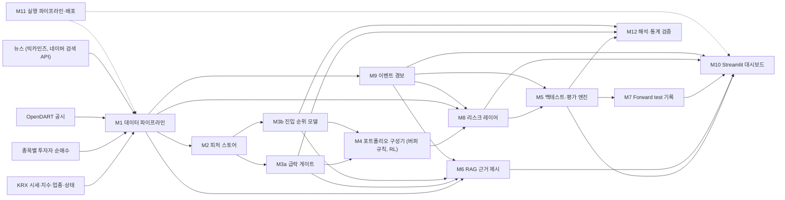

# 개인 투자자 종목 진입 판단 보조 시스템
## 프로젝트 명세서: 구조, 역할분담, 실행 기준

> 버전 v0.3 · 작성일 2026-10-27 · 상태: 팀 검토 전 · 사전등록 확정일 2026-11-09
>
> **AI에게:** 이 파일을 받으면 0장부터 읽는다. 사용자가 "나는 B 파트 담당이야"처럼 역할을 밝히면 0.5절 절차대로 그 역할의 다음 작업을 찾아 수행한다. 역할 없이 질문만 하면 이 문서를 근거로 답한다. 역할 없이 코드나 산출물 작성을 요청받으면, 시작하기 전에 9.1절 역할표를 보여주고 역할을 묻는다.
>
> **팀원에게:** AI에게 이 파일을 첨부하고 "나는 {역할} 파트 담당이야"라고 쓰면 된다. 특정 작업을 원하면 작업 ID를 덧붙인다. 예: "나는 B 파트 담당이야. B-04 해줘."

---

## 0. AI 에이전트 읽기 지침

### 0.1 문서의 지위와 읽는 순서

이 문서가 프로젝트의 유일한 기준이다. 내용이 서로 충돌하면 부록 1(사전등록 설정), 4장(데이터 규약과 타이밍), 6장(모듈 명세), 7장(성공 기준), 부록 2(작업 패키지), 나머지 설명의 순서로 우선한다.

AI는 0장, 부록 1, 4장, 자기 역할의 작업 패키지(부록 2)와 그 작업이 가리키는 6장 모듈, 7장, 9.3절(인터페이스), 부록 3(확인 필요 항목)의 순서로 읽는다.

이 문서의 ID 체계는 서로 다르다. 역할 ID는 PM, A, B, C, D이고, 작업 ID는 역할 ID에 번호를 붙인 것(예: B-04)이다. 확인 항목은 Q-01부터, 규칙은 R-01부터, 모듈은 M1부터, KPI는 G0부터 번호를 붙인다. 'B1', 'B2', 'B3'은 역할 B가 아니라 6.4절의 베이스라인 이름이다.

### 0.2 공통 규칙

모든 역할과 모든 작업에 적용한다. 리뷰와 보고에서는 규칙 ID로 지칭한다.

| ID | 규칙 |
|---|---|
| R-01 | 수치, 임계값, 날짜는 부록 1의 값만 쓴다. 부록 1과 본문이 다르면 부록 1을 따르고 불일치를 보고한다 |
| R-02 | 부록 1의 값을 바꾸지 않는다. 변경이 필요하면 제안만 하고, 사람이 승인한 경우에만 `docs/deviation_log.md`에 날짜, 사유, 변경 전후 값, 영향을 기록한 뒤 반영한다 |
| R-03 | 신호일 t의 모든 계산(피처, 필터, 노출 조절)에는 4.2절에서 허용한 정보만 쓴다. t+1일 이후의 가격, 공시, 뉴스, 수급은 라벨 계산과 성과 평가에만 쓴다 |
| R-04 | 학습, 튜닝, 체크포인트 선택에는 신호일이 2025-12-31 이하인 데이터만 쓰고 4.7절의 purge를 적용한다. 신호일이 2026-01-01~2026-10-31인 라벨과 성과는 2026-12-11 전에 계산하지 않는다 |
| R-05 | 모든 성과 지표는 M5의 함수로만 계산한다. 다른 코드로 계산한 수치는 보고서와 대시보드에 쓰지 않는다 |
| R-06 | 버퍼 규칙과 RL 포트폴리오는 M8(리스크 레이어)을 통과한 비중으로만 체결한다. 예외는 G2의 개인 행동 프록시, G6의 기간 비교, G7의 'M8·M9 미적용' 비교 실행, G4의 '노출 조절 제외' 진단 실행뿐이다 |
| R-07 | 종목코드, 날짜, 시각, 단위는 0.4절 표기 규약을 따른다 |
| R-08 | 존재를 확인하지 않은 API, 함수, 데이터 필드, 데이터셋을 가정하지 않는다. 부록 3에서 확인 결과가 비어 있는 항목이나 부록 1에서 `FILL_`로 시작하는 값에 의존하는 실제 실행·판정은 멈추고 보고한다. 구현 작업에서는 그런 값을 함수 인자나 설정값으로 받게 만들고, 단위 테스트에만 임의의 값을 쓴다 |
| R-09 | 문서에 정의되지 않은 결정은 임의로 정하지 않고 0.3절 형식으로 보고한다 |
| R-10 | 모든 실험은 설정 파일과 시드만으로 재현할 수 있어야 하며, `reports/{run_id}/`에 설정 사본, git 커밋 해시, 지표 JSON을 저장한다 |
| R-11 | KPI 미달, 실패한 실험, 버그로 인한 재실행을 숨기지 않는다. 실패한 실험의 결과도 지우지 않는다 |
| R-12 | 사용자에게 보이는 출력(신호, 경보, 근거 요약, 대시보드)에는 매수·매도를 권유하는 표현을 쓰지 않고 2.3절의 고지 문구를 넣는다 |
| R-13 | 재무제표 피처, 해외 데이터, 장중(분·틱) 데이터, NXT·애프터마켓 데이터는 쓰지 않는다 |
| R-14 | 13장 용어와 부록 1·9.3절의 변수명, 파일명을 그대로 쓴다. 같은 대상에 새 이름을 만들지 않는다 |
| R-15 | 표본 외 결과(walk-forward 테스트 연도)를 본 뒤 바꾼 설계는 '탐색' 결과로만 보고한다. KPI 판정에는 사전등록 시점의 설계를 쓴다 |
| R-16 | API 키, 토큰, 계정 정보를 코드, 문서, 커밋, 로그, AI 대화에 쓰지 않는다. 코드는 환경 변수 이름(`OPENDART_API_KEY`, `NAVER_CLIENT_ID`, `NAVER_CLIENT_SECRET`)으로만 참조한다. 실제 값은 PM이 관리하며, AI는 키 값을 요구하거나 출력하지 않는다 |
| R-17 | 선언된 역할의 작업 패키지 밖의 작업은 하지 않는다. 다른 역할의 산출물이 필요하면 9.3절 스키마를 따르는 스텁으로 대신하고(6.12절), 그 담당자에게 넘길 요청을 보고에 적는다. 다른 역할이 소유한 파일은 그 담당자의 승인 없이 고치지 않는다 |
| R-18 | 9.3절의 파일은 `src/common/io.py`의 함수로만 읽고 쓴다 (스키마 검증, 6.12절) |

### 0.3 모호할 때의 처리

문서만으로 결정할 수 없으면 임의로 정하지 않고 아래 형식으로 보고한 뒤 사람의 결정을 기다린다. 사람이 결정하면 PM이 `docs/decisions.md`에 날짜, 결정자, 내용을 기록한다.

```text
[결정 필요]
상황: 무엇을 하다가 어디서 막혔는지
관련 조항: 절 번호, 작업 ID, 규칙 ID
선택지: A) …  B) …  C) …
추천: 선택지 하나와 그 이유
영향: 바뀌는 파일, 지표, 일정, 다른 역할
```

### 0.4 표기 규약

| 항목 | 규약 |
|---|---|
| 종목코드 | 6자리 문자열 (`"005930"`). 정수로 변환하지 않는다 (앞자리 0 손실 방지) |
| 날짜 | `YYYY-MM-DD`. 모든 날짜는 KRX 거래일 기준 한국 날짜 |
| 시각 | 한국 표준시(KST), ISO 8601 형식 (`2026-11-06T15:30:00+09:00`) |
| 금액 | 원(KRW), 정수 |
| 비율·수익률 | 소수로 저장한다 (0.15 = 15%). 본문의 '%p'는 소수의 차이다 (3%p = 0.03) |
| 수익률 종류 | 단순수익률. 로그수익률은 변동성 계산에만 쓴다 |
| 가격 | KRX 정규장 수정종가(`close`). 원시 종가(`close_raw`)는 동전주 판정에만 쓴다 |
| 거래일 표기 | 'n거래일'은 KRX 개장일 기준이다. t−k, t+k는 t로부터 k번째 이전·이후 거래일이다 |
| 연율화 | 일간 252, 주간 52 |
| 현금 | 이자 0%로 가정한다 |
| 정밀도 | 계산과 저장은 float64, 보고는 소수 넷째 자리 |
| 수식 기호 | 본문과 수식 블록의 '−', '×', '÷', '≥', '≤', '√'는 수학 기호다. 코드로 옮길 때는 ASCII 연산자와 함수로 바꾼다 |

### 0.5 역할 선언 처리

사용자가 역할을 밝히면 AI는 아래 순서를 그대로 따른다. 역할 선언 없이 질문만 하면 이 절을 적용하지 않고 문서를 근거로 답한다. 역할 선언 없이 코드나 산출물 작성을 요청받으면 시작하기 전에 역할부터 묻는다.

| 단계 | AI가 할 일 |
|---|---|
| 1. 역할 확인 | 사용자 말에서 역할 ID, 담당자 이름, 별칭(9.1절)을 찾아 역할을 정한다. 찾지 못하거나 둘 이상이 맞으면 9.1절 표를 보여주고 한 번만 묻는다 |
| 2. 날짜 확인 | 오늘 날짜(KST)를 정한다. 사용자 메시지에 날짜가 있으면 그것을, 없으면 AI가 아는 현재 날짜를 쓰고 시작 보고에 적는다. 알 수 없으면 묻는다 |
| 3. 진행 상황 확인 | 다음 우선순위로 확인한다. (a) 사용자가 말한 작업 ID와 완료 상황. (b) 첨부되었거나 저장소에 있는 `docs/status.md`(부록 4 형식). (c) 둘 다 없으면 그 역할의 작업 중 기한이 오늘 이전이거나 이번 주인 작업 목록을 보여주고, 완료한 작업 ID를 한 번만 묻는다 |
| 4. 작업 선택 | 사용자가 작업 ID를 지정했으면 그 작업을 한다. 아니면 상태가 '진행 중'인 작업, 없으면 '대기' 작업 가운데 실행 가능한 작업 중 기한이 가장 이른 것을 고른다. 실행 가능 여부는 부록 2의 '유형'으로 판단한다. '구현' 작업은 미완료 선행 산출물을 스텁으로 대신해 진행할 수 있다. '조사', '판정', '운영' 작업은 선행 작업이 모두 완료되어야 한다. 선행이 '없음'이면 바로 할 수 있다 |
| 5. 시작 보고 | 작업 전에 역할, 오늘 날짜, 선택한 작업 ID와 이유, 입력 파일, 산출물, 완료 기준, 관련 절과 규칙, 기한이 지난 미완료 작업을 보고한다 |
| 6. 수행 | 0.2절 규칙을 지키며 작업한다. 저장소에 접근할 수 있는 AI는 파일을 직접 만들고 테스트를 실행한다. 대화형 AI는 파일 경로별 코드 블록과 실행 방법을 제시한다 |
| 7. 종료 보고 | (a) 만들거나 바꾼 파일, (b) 완료 기준별 통과 여부, (c) `docs/status.md`에 붙여 넣을 갱신 행, (d) 남은 [결정 필요], (e) 다른 역할에 넘길 요청, (f) 다음 작업 ID |

| 사용자 말 | 해석 |
|---|---|
| "나는 B 파트 담당이야" | 역할 B(조윤상). 3~4단계로 다음 작업을 고른다 |
| "B 파트야. B-04 해줘" | 역할 B, 작업 B-04 |
| "강화학습 파트 맡고 있어" | 별칭으로 역할 B |
| "손석범인데 SHAP 하려고" | 역할 C. SHAP는 작업 C-06 |
| "대시보드 담당이야" | 별칭으로 역할 D |

---

## 1. 개요

### 1.1 한 줄 요약

국내 주식을 직접 매매하는 개인 투자자가 종목에 진입하기 전에, 향후 20거래일의 급락 위험과 지수 대비 초과수익 순위를 근거(공시·뉴스)와 함께 Streamlit 대시보드로 제공하는 정보제공형 의사결정 보조 시스템.

### 1.2 배경

팀의 기존 역할 분담(9.1절)은 그대로 살려 새 구조의 모듈에 배정했다.

한국 시장에서는 단기 모멘텀의 근거가 약하고, 개인이 최근 급등 종목을 추격 매수하다 손실을 보는 구조가 확인된다(12장). 그래서 핵심 기여는 '사면 안 되는 종목 걸러내기'(급락 게이트)에 두고, '지수를 이기는 종목 고르기'(진입 순위)는 도전 목표로 둔다. 모든 포트폴리오는 종목·업종 한도와 시장 노출 조절로 이루어진 리스크 레이어(M8)를 거친다.

### 1.3 검증할 주장

| 번호 | 주장 | 성격 | KPI |
|---|---|---|---|
| 주장 1 | 급락 게이트를 적용하면 개인의 전형적인 매수 행동에서 손실 꼬리가 줄어든다 | 핵심 | G1, G2 |
| 주장 2 | 진입 순위 모델로 고른 long-only 포트폴리오가 비용 차감 후 코스피 200을 이긴다 | 도전 | G3, G4 |
| 주장 3 | 비용을 인식하는 RL 정책이 같은 신호를 쓰는 버퍼 규칙보다 순성과가 높다 | RL 기여 | G5 |
| 주장 4 | 1·5거래일 예측은 비용을 반영하면 성과가 무너진다 | 검증 | G6 |
| 주장 5 | 리스크 레이어는 수익을 크게 해치지 않으면서 최대 낙폭을 줄이고, 한도를 한 번도 어기지 않는다 | 방어 | G0, G7 |

### 1.4 v0.2 대비 변경 사항

v0.1에서 v0.2로 바뀐 내용(다음 거래일 종가 체결, 코스피 200 가격지수 벤치마크, 리스크 레이어 M8, 이벤트 경보 M9, G0·G7 추가)은 그대로 유지한다.

| 항목 | v0.2 | v0.3 | 이유 |
|---|---|---|---|
| 역할 체계 | A~D 4역할 (A 데이터·평가, B 예측 모델, C 공시·뉴스·RAG, D 포트폴리오·리스크) | PM과 A~D 5역할. 실제 담당자와 기존 역할 분담 기준 (B = 강화학습) | 팀의 기존 역할 분담 반영. v0.2와 역할 문자의 뜻이 다르므로 v0.3을 기준으로 한다 |
| 배포 | 없음 | Streamlit 대시보드(M10), 실행 파이프라인·배포(M11) | 기존 배포 계획 반영 |
| 해석·검증 | 없음 | SHAP와 ANOVA(M12, 보조 분석) | 기존 역할 분담 반영 |
| AI 작업 방식 | 역할별 첫 작업 예시 | 역할 선언 처리(0.5절), 작업 패키지(부록 2), 진행 현황 템플릿(부록 4) | 역할만 밝히면 AI가 다음 작업을 찾아 수행하게 함 |
| 기밀 정보 | 규정 없음 | R-16, PM이 관리 | 기존 역할 분담의 기밀 정보 관리 반영 |
| 모듈 간 입출력 | 파일 스키마만 정의 | `src/common/io.py`로만 읽고 쓰기 (R-18) | 모듈 연결 담당(D)이 스키마를 강제 |
| 홀드아웃 개봉 | 데이터·평가 담당이 실행 | C가 실행하고 PM이 승인·기록 | 평가와 기밀 관리의 분리 |
| 부록 체계 | 부록 A·B·C, 확인 항목 C-xx | 부록 1~5, 확인 항목 Q-xx | 역할 C와 혼동 방지 |
| forward test 첫 경보 | 로지스틱 게이트 | 판정용 베이스라인은 로지스틱 회귀. forward test 첫 기록(11/6, 11/13)은 vol_60 상위 10% 플래그 (단일 변수 로지스틱과 순위가 같음) | 라벨 없이 11/6부터 기록 가능 |
| 버퍼 규칙 기한 | 11/6 | 11/13 | M5 엔진(11/6) 완성 후로 조정 |

---

## 2. Target audience와 산출물

### 2.1 대상과 가정

| 항목 | 정의 |
|---|---|
| 대상 | 국내 주식을 위탁계좌로 직접 매매하는 개인 중, 최근 급등하거나 화제가 된 종목을 따라 사는 경향이 있는 투자자 |
| 투자 가정 | 공매도, 레버리지, 신용, 미수를 쓰지 않는다. 대주주가 아니다(양도세 없음). 신호일 장 마감 후 주 1회 점검하고, 주중에는 M9 경보만 받는다 |
| 자금 가정 | 이 시스템이 다루는 돈은 투자자의 직접투자용 일부 자금(위성 자금)이다. 자산 전체 배분은 다루지 않는다 |
| 선정 이유 | 개인의 가장 흔한 매수 행태이자 손실이 몰리는 지점이라, '원래 했을 행동' 대비 개선을 숫자로 증명할 수 있다 (G2) |

### 2.2 산출물

모든 산출물은 파일로 저장되고, Streamlit 대시보드(M10, 6.11절)가 그 파일을 읽어 보여준다.

| 산출물 | 내용 | 주기 | 파일 | 대시보드 페이지 |
|---|---|---|---|---|
| 진입 금지 경보 | crash_flag = 1인 종목과 급락 확률 | 매주 신호일 | `signals/{t}.parquet` | 이번 주 신호 |
| 진입 후보 순위 | crash_flag = 0이고 M9 쿨다운이 아닌 종목을 rank 오름차순으로 20개 | 매주 신호일 | `signals/{t}.parquet` | 이번 주 신호 |
| 모델 포트폴리오 | M8 적용 후 목표 비중, 현금 비중, 노출 상한 E_t, 모멘텀 붕괴 국면 여부 | 매주 신호일 | `positions/{t}.parquet` | 이번 주 신호 |
| 근거 요약 | 경보, 후보, 주중 경보 종목별 공시·뉴스 근거와 출처 | 매주 신호일 | `evidence/{t}.jsonl` | 근거 |
| 주중 경보 | M9 트리거가 발생한 보유·후보 종목 | 매 거래일 | `alerts/{d}.parquet` | 주중 경보 |
| 성과·KPI | 확정된 실험 결과 | 결과 확정 시 | `reports/final/` | 성과 |
| forward test 기록 | 신호 커밋 해시와 사후 성과 | 매주 | `forward_log.csv` | forward test |

### 2.3 서비스 형태와 고지 문구

정보제공형 서비스다. 투자자문·일임이 아니며 주문을 실행하지 않는다. 실서비스로 확장할 경우 투자자문 해당 여부를 법률 검토한다. 사용자에게 보이는 모든 출력과 대시보드의 모든 페이지에 아래 문구를 그대로 넣는다.

> 본 정보는 정보 제공 목적이며 특정 종목의 매수·매도를 권유하지 않습니다. 투자 판단과 그 결과의 책임은 투자자 본인에게 있습니다.

---

## 3. 범위

| 포함 | 제외 |
|---|---|
| 4.4절 유니버스의 KOSPI·KOSDAQ 보통주 | 자산 전체 배분, 투자일임, 주문 자동 실행, 실계좌 연동 |
| 20거래일 예측(본선), 1·5거래일 예측(G6 비교 실험) | 1·5거래일 전략의 서비스화 |
| long-only와 현금 | 공매도, 레버리지·인버스 상품, 신용·미수 |
| 가격, 거래대금, 수급, 공시, 뉴스 피처 | 재무제표 피처, 해외 데이터, 장중(분·틱) 데이터, NXT·애프터마켓 데이터 |
| 주간 신호, 주중 이벤트 경보, forward test | 실계좌 운용 |
| Streamlit 대시보드(파일 읽기 전용), 주간·일간 실행 파이프라인 | 별도 웹 API 서버, 대시보드에서의 모델 실행이나 외부 API 호출 |

---

## 4. 데이터 규약과 타이밍

이 장의 정의는 모든 모듈에 똑같이 적용한다. 구현은 `src/common/`의 공용 함수로 한 번만 하고, 모듈마다 다시 만들지 않는다.

### 4.1 거래일과 신호일

| 항목 | 정의 |
|---|---|
| 거래일 | KRX 정규장이 열린 날. 캘린더 원천은 부록 3 Q-14에서 확정한다 |
| 신호일 t | 각 주(월~일)의 마지막 거래일. 보통 금요일이며, 금요일이 휴장이면 그 주의 마지막 거래일 |
| 신호 생성 시각 | 신호일 15:30(정규장 종가 확정) 이후, 같은 날 23:59 이전 |
| G6 예외 | h = 1 실험은 매 거래일, h = 5 실험은 5거래일마다, h = 20 실험은 20거래일마다 신호를 만든다 (6.4절) |

### 4.2 정보 시점 규칙

| 데이터 | 신호일 t의 계산에 쓸 수 있는 범위 |
|---|---|
| 가격, 거래대금, 시가총액 | t일 KRX 정규장 종가까지 |
| 코스피 200 지수 | t일 종가까지 |
| 투자자별 순매수 | t−1일까지 (t일 자료는 장 마감 후 공개되므로) |
| 공시 | 접수 시각이 t일 15:30 이전인 것 |
| 뉴스 | 발행 시각이 t일 15:30 이전인 것 |
| 관리종목, 거래정지, 지수 구성종목 | t일 기준 상태 |
| 업종 분류 | t일에 유효한 분류 (시점별 이력이 없으면 부록 3 Q-04의 결정을 따른다) |

### 4.3 체결 규칙

M5(백테스트), M4(RL 환경), M7(forward test)은 모두 이 규칙을 구현한 같은 함수(C 소유)를 호출한다.

| 상황 | 규칙 |
|---|---|
| 기본 | 신호일 t의 목표 비중은 t+1일 종가에 체결한다 |
| 상한가 근접 | t+1일 종가의 전일 대비 수익률이 +0.295 이상이면 그 종목은 매수하지 않고 해당 금액을 현금으로 둔다 |
| 하한가 근접 | t+1일 종가의 전일 대비 수익률이 −0.295 이하이면 그 종목은 매도하지 않고 보유한다. 리밸런싱 매도는 다음 신호일에 다시 판단하고, M9 이벤트 청산은 다음 거래일 종가에 다시 시도한다 |
| 거래정지 | 정지 중에는 마지막 거래일 수정종가로 보유분을 평가하고 체결하지 않는다. 정지로 놓친 리밸런싱 매도는 재개 첫날 종가에 최신 목표 비중 초과분만 처리한다. 재시도·회전율·비용은 DEC-25를 따르고, v1의 정지 판정은 DEC-26을 따른다 |
| 상장폐지 | 보유 중 상장폐지되면 정리매매 마지막 종가로 청산한다. 정리매매 가격이 없으면 0으로 청산한다 |
| 거래량 | 수량 제약은 두지 않는다 (유니버스의 거래대금 하한으로 대신한다) |

### 4.4 유니버스 U_t

신호일 t마다 아래 단계를 순서대로 적용한다. 결과 종목 수 N_t는 500 이하이며, 매 신호일 `universe.parquet`에 기록한다.

| 단계 | 규칙 |
|---|---|
| 1 | KOSPI·KOSDAQ 상장 보통주만 남긴다. 우선주, ETF, ETN, 리츠, 인프라펀드, 종목명에 '스팩'이 들어간 종목은 제외한다. 증권 종류는 `tickers.parquet`의 `security_type`으로 판별하며, 판별 규칙은 부록 3 Q-15에서 확정한다 |
| 2 | 실제 상장일부터 센 거래일 수가 60일 미만인 종목을 제외한다 |
| 3 | t일 기준 관리종목과 거래정지 종목을 제외한다 |
| 4 | t일 종가 기준 시가총액 상위 500종목을 고른다 |
| 5 | t−19일부터 t일까지 20거래일 평균 거래대금이 10억 원 미만인 종목을 제외한다 |

### 4.5 벤치마크

| 구분 | 정의 |
|---|---|
| 주 벤치마크 BM | 코스피 200 가격지수 종가. 종목 수익률(수정종가)이 현금배당을 반영하지 않으므로 같은 기준으로 맞춘다. 부록 3 Q-05에서 종목 데이터가 배당을 반영한다고 확인되면 코스피 200 TR로 바꾸고 deviation log에 기록한다 |
| 보조 벤치마크 EW | U_t 종목 동일가중, 매 신호일 리밸런싱, 비용 미반영 |

### 4.6 라벨

라벨은 C가 `labels.parquet` 하나로 만들고, 다른 역할은 이 파일만 읽는다. 종목 i ∈ U_t, 예측 기간 h에 대해 다음과 같이 정의한다.

```text
R_i(t,h)      = close_i(t+1+h) / close_i(t+1) − 1
R_BM(t,h)     = BM(t+1+h) / BM(t+1) − 1
ER_i(t,h)     = R_i(t,h) − R_BM(t,h)
y_rank_i(t,h) = U_t 안에서 ER_i(t,h)의 백분위 순위   # pandas rank(pct=True, method="average")
y_crash_i(t)  = 1 if ER_i(t,20) <= −0.15 else 0
```

| 예외 상황 | 처리 |
|---|---|
| t+1일에 거래정지 | 라벨을 만들지 않는다 (학습과 IC 계산에서 제외) |
| t+1+h일에 거래정지 | 거래 재개 첫날 종가를 쓴다 |
| 기간 중 상장폐지 | 정리매매 마지막 종가를 쓰고, 없으면 가격을 0으로 본다 |
| 계산 시점까지 거래 재개 없음 | 라벨을 만들지 않고, 결측 건수를 리포트에 적는다 |

### 4.7 데이터 분할

| 구분 | 신호일 범위 | 용도 |
|---|---|---|
| 첫 학습 신호일 | 2011년 첫 신호일 (피처에 252거래일 이력이 필요하므로) | |
| walk-forward 테스트 | Y = 2016, 2017, …, 2025 각 연도의 신호일 | KPI 판정 |
| 폴드 Y의 학습 | 2011년 ~ (Y−3)년 신호일 | 모델 적합 |
| 폴드 Y의 검증 | (Y−2)년, (Y−1)년 신호일 | 하이퍼파라미터, λ, 체크포인트 선택 |
| 폴드 Y의 테스트 모델 | 다시 적합하지 않는다. LightGBM 모델과 M3a 보정기는 학습 구간으로 적합하고 검증 구간으로 고른 그대로, RL은 검증 구간으로 고른 체크포인트를 그대로 테스트에 쓴다 | 테스트 예측 |
| 연도 경계 | 포트폴리오는 보유를 유지한 채 다음 폴드의 모델로 바꾼다 | |
| 홀드아웃 H | 2026-01-01 ~ 2026-10-31 신호일. 최종 모델은 2011~2023년 학습, 2024~2025년 검증으로 만든다 | 1회 평가 (2026-12-11) |
| forward test | 2026-11-06 이후 신호일. 홀드아웃과 같은 최종 모델을 쓴다 | 누수 없음 증명 |

Purge 규칙은 다음과 같다. 구간 경계마다, 라벨 계산에 다음 구간 첫 신호일 이후 가격을 쓰게 되는 신호일을 앞 구간에서 제거한다. 즉 t+1+h ≥ (다음 구간 첫 신호일)인 신호일 t를 뺀다. 학습과 검증 사이, 검증과 테스트 사이, 학습 전체와 홀드아웃 사이에 모두 적용한다.

`src/common/guards.py`(C 소유)는 두 가지를 강제한다. 첫째, 학습·튜닝 코드에 2025-12-31보다 늦은 신호일이 들어오면 예외를 발생시킨다. 둘째, 신호일 2026-01-01~2026-10-31의 라벨은 `--allow-holdout` 플래그가 있고 실행일이 2026-12-11 이후일 때만 만든다. 홀드아웃 평가는 C가 실행하고, PM이 승인 사실과 실행 시각을 `docs/decisions.md`에 기록한다.

### 4.8 비용

| 항목 | 값 | 적용 대상 |
|---|---|---|
| 증권거래세 `sell_tax` | 0.0020 | 매도 금액 |
| 수수료 `commission_per_side` | 0.00015 | 매수 금액, 매도 금액 각각 |
| 슬리피지 `slippage_per_side` | 0.0010 | 매수 금액, 매도 금액 각각 |
| 2배 비용 시나리오 `stress_multiplier` | 2.0 | 위 세 값에 모두 곱한다 |

```text
매수 비용 = 매수 금액 × (commission_per_side + slippage_per_side)
매도 비용 = 매도 금액 × (sell_tax + commission_per_side + slippage_per_side)
```

전 기간에 같은 값을 적용한다. 과거 실제 세율과의 차이는 2배 비용 시나리오로 확인한다.

### 4.9 공매도 규제 레짐

피처 `ss_regime`과 `ss_allowed`의 기준이다. 2026-11-02 Q-11에서 금융위원회 원문으로 확인한 정책 효력의 달력일 구간을 아래에 기입했다. 실제 피처는 A의 거래일 캘린더에 맞춰 적용한다. 금융주만 금지된 과거 구간은 기존 숫자 계약으로 표현되지 않아 부호화를 미확정으로 남긴다.

| 기간 | `ss_regime` | 내용 | 검증 |
|---|---|---|---|
| 2008-10-01 ~ 2009-05-31 | 2 | 전 종목 금지 (학습 시작 전 참고) | [금융위 과거 조치 표](https://www.fsc.go.kr/po010102/74200) |
| 2009-06-01 ~ 2011-08-09 | 미확정 | 비금융주 허용·금융주 금지 | [금융위 과거 조치 표](https://www.fsc.go.kr/po010102/74200) |
| 2011-08-10 ~ 2011-11-09 | 2 | 전 종목 금지 | [금융위 과거 조치 표](https://www.fsc.go.kr/po010102/74200) |
| 2011-11-10 ~ 2013-11-13 | 미확정 | 비금융주 허용·금융주 금지 | [금융위 과거 조치 표](https://www.fsc.go.kr/po010102/74200) |
| 2013-11-14 ~ 2020-03-15 | 0 | 금융주 금지 해제, 전 종목 허용 | [2013 해제](https://fsc.go.kr/po010106/70903), [2020 금지 시작](https://www.fsc.go.kr/po010102/74200) |
| 2020-03-16 ~ 2021-05-02 | 2 | 전 종목 금지 | [2020 시작](https://www.fsc.go.kr/po010102/74200), [2021 연장·부분 재개](https://www.fsc.go.kr/po010106/75290) |
| 2021-05-03 ~ 2023-11-05 | 1 | 코스피 200·코스닥 150 구성종목만 허용 | [2021 부분 재개](https://www.fsc.go.kr/po010106/75290), [2023 금지](https://www.fsc.go.kr/no010101/81013) |
| 2023-11-06 ~ 2025-03-30 | 2 | 전 종목 금지 | [2023 시작](https://www.fsc.go.kr/no010101/81013), [2024 연장](https://www.fsc.go.kr/no010103/82469?curPage=3) |
| 2025-03-31 ~ | 0 | 전 종목 재개. 이후 추가 조치는 별도 추적 | [2025 재개](https://www.fsc.go.kr/no010101/84216) |

`ss_allowed`는 `ss_regime`이 0이면 1, 1이면 그 종목이 t일에 코스피 200 또는 코스닥 150 구성종목일 때만 1, 2이면 0이다.

DEC-29에 따라 v1에서는 과거 구성종목 여부를 확인할 수 없는 `ss_allowed`를 결측으로 저장한다. 모델 입력에서는 `ss_allowed`를 제외하고 `ss_regime`을 유지한다.

위 숫자 정의는 금융주만 금지된 구간을 아직 다루지 못한다. 그 구간을 0 또는 기존 1로 임의 대체하지 않으며, A/C와 부호화·시점별 금융주 구분 근거를 맞추기 전 해당 구간의 피처 생성·평가를 완료로 표시하지 않는다. 2021 부분 재개도 현재 구성종목을 과거에 소급하지 않는다. 표의 '금지'는 일반 공매도 정책 범위이며 시장조성자·유동성공급자 등의 허용 예외가 있다. 종목별 공매도 과열 금지는 이 시장 공통 표와 별도다. 정책 종료일과 마지막 거래일을 구분하므로 기존 2021-04-30·2023-11-03·2025-03-28 표시는 각각 다음 주말까지 포함한 달력 구간으로 보완했다. 이 조사는 YAML 값이나 피처 코드를 변경하지 않는다.

---

## 5. 시스템 구조

### 5.1 모듈 구성



| 모듈 | 이름 | 역할 | 담당 | 명세 |
|---|---|---|---|---|
| M1 | 데이터 파이프라인 | 시세, 지수, 종목 정보, 업종, 상태, 수급, 공시, 뉴스를 시점별로 수집·정제 | A (가격·시장 데이터), PM (공시·뉴스) | 6.1절 |
| M2 | 피처 스토어 | 신호일별 종목 피처 행렬 | A (가격·수급·제도·시장 피처), PM (이벤트·뉴스 피처) | 6.2절 |
| M3a | 급락 게이트 | 향후 20거래일 급락 확률과 플래그 | A | 6.3절 |
| M3b | 진입 순위 모델 | 향후 20거래일 초과수익 순위 | A | 6.4절 |
| M4 | 포트폴리오 구성기 | 버퍼 규칙과 RL 정책으로 원시 목표 비중 생성 | B | 6.5절 |
| M5 | 백테스트·평가 엔진 | 라벨, 체결, 비용, NAV, 모든 지표 계산, 홀드아웃 가드 | C | 6.6절 |
| M6 | RAG 근거 제시 | 신호별 공시·뉴스 근거 요약과 출처 | PM | 6.7절 |
| M7 | Forward test 기록 | 매주 신호를 커밋해 시점을 증명하고 사후 성과 기록 | D (사후 성과 계산 함수는 C) | 6.8절 |
| M8 | 리스크 레이어 | 필터(위험 태그 적용), 종목·업종 한도, 시장 노출 조절, 모멘텀 붕괴 국면 대응 | B | 6.9절 |
| M9 | 이벤트 경보 | 매 거래일 공시를 감시해 경보(위험 태그)와 청산 신호 발생 | PM | 6.10절 |
| M10 | Streamlit 대시보드 | 산출물 파일을 읽어 보여주는 화면 | D | 6.11절 |
| M11 | 실행 파이프라인·배포 | 주간·일간 실행기, 모듈 간 입출력(`io.py`), 실행 환경, 배포 | D | 6.12절 |
| M12 | 해석·통계 검증 | SHAP 해석, ANOVA 보조 분석 | C | 6.13절 |

### 5.2 운영 순서

walk-forward 백테스트는 아래 1~5단계를 과거 신호일 전체에 대해 일괄 실행하고, 결과를 9.3절의 `wf_` 파일에 저장한다. 실행 명령은 6.12절에 있다.

| 순서 | 시점 | 모듈 | 내용 | 출력 |
|---|---|---|---|---|
| 1 | 신호일 t 15:30 이후 | M1 | t까지의 데이터 갱신 | `data/processed/` |
| 2 | 신호일 t 15:30 이후 | M2 | 피처 계산 | `features/{t}.parquet` |
| 3 | 신호일 t 15:30 이후 | M3a, M3b | 급락 확률·플래그, 순위 점수 | `signals/{t}.parquet` |
| 4 | 신호일 t 15:30 이후 | M4 | 원시 목표 비중 w_raw 생성 | 저장하지 않음 |
| 5 | 신호일 t 15:30 이후 | M8 | 리스크 레이어 적용 | `positions/{t}.parquet` |
| 6 | 신호일 t 15:30 이후 | M6 | 근거 요약 | `evidence/{t}.jsonl` |
| 7 | 신호일 t 23:59 이전 | M7 | 신호·비중 커밋, 해시 기록 | `forward_log.csv` |
| 8 | t+1일 15:30 이후 | M5 | 종가 체결, 성과 추적 | `reports/` |
| 매 거래일 | 장 마감 후 | M9 | 공시 감시, 경보 | `alerts/{d}.parquet` |
| 상시 | 파일 갱신 시 | M10 | 대시보드 표시 | 화면 |

### 5.3 저장소 구조

```
project/
├── configs/
│   └── prereg.yaml        # 부록 1. 2026-11-09 커밋 후 수정 금지 (R-02)
├── data/
│   ├── raw/{수집일}/      # 원천 응답 그대로, 덮어쓰기 금지
│   └── processed/         # 9.3절 스키마의 정제 테이블과 labels.parquet
├── src/
│   ├── common/            # io.py(D), guards.py(C), 거래일 캘린더(A), 체결 규칙(C)
│   ├── data/              # M1 (A: 가격·시장, PM: 공시·뉴스)
│   ├── features/          # M2 (A, PM)
│   ├── models/            # M3a, M3b (A)
│   ├── portfolio/         # M4 버퍼 규칙·RL, M8 리스크 레이어 (B)
│   ├── backtest/          # M5 라벨·NAV·비용·지표 (C)
│   ├── analysis/          # M12 SHAP·ANOVA (C)
│   ├── events/            # M9 (PM)
│   ├── rag/               # M6 (PM)
│   └── pipeline/          # M11 run_weekly, run_daily_alerts (D)
├── app/                   # M10 Streamlit 대시보드 (D)
│   ├── Home.py
│   └── pages/
├── features/              # 신호일별 피처 행렬
├── signals/               # 신호 (forward test는 날짜별 파일, 백테스트는 wf_ 파일)
├── positions/             # M8 적용 후 목표 비중
├── alerts/                # M9 경보
├── evidence/              # M6 근거 요약
├── reports/{run_id}/      # 실험별 결과 (실패한 실험 포함)
├── reports/final/         # C가 확정한 최종 결과 (대시보드가 읽는 유일한 성과 폴더)
├── _stub/                 # 스텁 출력 (커밋·대시보드 대상 아님)
├── logs/                  # 실행 로그
├── forward_log.csv        # M7 기록
├── .env.example           # 환경 변수 이름만 (값 없음, R-16)
├── .gitignore             # .env, .streamlit/secrets.toml, data/raw/ 포함
└── docs/
    ├── status.md          # 작업 진행 현황 (부록 4)
    ├── preregistration.md # 사전등록 커밋 해시와 날짜
    ├── deviation_log.md   # 사전등록 이후 변경 기록 (R-02)
    └── decisions.md       # [결정 필요] 처리 기록 (0.3절)
```

---

## 6. 모듈 명세

### 6.1 M1 데이터 파이프라인 (담당 A: 김윤하 / 공시·뉴스는 PM: 장지원)

| 항목 | 내용 |
|---|---|
| 담당 구분 | A는 시세, 지수, 종목 정보, 상태, 업종, 상장폐지, 투자자별 순매수를 맡는다. PM은 공시(OpenDART)와 뉴스(빅카인즈, 네이버 검색 API)를 맡는다 |
| 원천 | KRX 정보데이터시스템, 종목별 투자자 순매수(원천은 부록 3 Q-01), OpenDART, 빅카인즈, 네이버 검색 API. 수집 도구 후보는 pykrx와 FinanceDataReader이며, 실제 커버리지는 부록 3에서 확인한다 |
| 출력 (A) | `prices`, `index`, `tickers`, `status`, `universe`, `delisted`, `sector`, `investor_flows` (9.3절) |
| 출력 (PM) | `disclosures`, `news` (9.3절) |
| 처리 규칙 | KRX 정규장 데이터만 쓴다 (R-13). 원천 응답은 `data/raw/{수집일}/`에 그대로 보관하고 덮어쓰지 않는다. API 키는 환경 변수로만 읽는다 (R-16). 파일은 `io.py`로만 쓴다 (R-18) |
| 완료 기준 (A) | (1) 2010-01-04 이후 모든 거래일에 코스피 200 종가가 있다. (2) 2010년 이후 상장폐지된 종목이 prices에 들어 있고, 그 수를 리포트에 적는다. (3) 모든 ticker 열이 6자리 문자열이다. (4) 액면분할 사례 3건에서 수정종가가 끊기지 않는지 수작업으로 확인한다. (5) 신호일별 N_t 시계열 그림이 있다 |
| 완료 기준 (PM) | (1) disclosures에 2010년 이후 접수분이 있고, `rcept_dt`가 KST 시각까지 있으며, `report_nm_norm`이 6.10절 규칙으로 정규화되어 있다. (2) news의 출처별 수집 기간과 건수 표가 있다. (3) 원천별로 수집되지 않은 기간을 표로 적는다 |
| 관련 KPI | 모든 KPI의 전제 |

### 6.2 M2 피처 스토어 (담당 A: 김윤하 / 이벤트·뉴스 피처는 PM: 장지원)

피처는 아래 표에 있는 것만 만든다 (R-13, R-14). P는 수정종가, V는 거래대금, MC는 시가총액, BM은 코스피 200 종가다.

| 피처 | 정의 | 변환 | 담당 |
|---|---|---|---|
| `mom_12_1` | P(t−21) / P(t−252) − 1 | 순위 | A |
| `mom_12_7` | P(t−147) / P(t−252) − 1 | 순위 | A |
| `rev_1m` | P(t) / P(t−21) − 1 | 순위 | A |
| `rev_1w` | P(t) / P(t−5) − 1 | 순위 | A |
| `high52_prox` | P(t) / max(P(t−251), …, P(t)) | 순위 | A |
| `vol_20` | t−19~t 일간 로그수익률의 표준편차(ddof=1) × √252 | 순위 | A |
| `vol_60` | t−59~t 일간 로그수익률의 표준편차(ddof=1) × √252 | 순위 | A |
| `max_ret_20` | t−19~t 일간 단순수익률의 최댓값 | 순위 | A |
| `turnover_spike` | mean(V/MC, t−4~t) / mean(V/MC, t−64~t−5) | 순위 | A |
| `log_mcap` | ln(MC(t)) | 순위 | A |
| `penny_flag` | close_raw(t) < 1,000이면 1, 아니면 0 | 원값 | A |
| `ss_allowed` | 4.9절 정의. v1 모델 입력 제외(DEC-29) | 원값. 확인 불가 시 결측 | A |
| `ev_earnings`, `ev_buyback`, `ev_cancel`, `ev_dividend`, `ev_rights`, `ev_cbbw` | 접수일이 t−19~t이고 접수 시각이 t일 15:30 이전인 해당 유형 공시가 있으면 1, 없으면 0. 유형은 정규화한 보고서명(`report_nm_norm`, 6.10절)이 부록 1 `features.event_keywords`의 키워드를 포함하고, `events.title_filters`의 후속 정정·철회·취소 공시에 해당하지 않는지로 판정한다 (Q-13 검토안) | 원값 | PM |
| `news_cnt_spike` | (t−4~t 기사 수 + 1) / ((t−64~t−5 기사 수) × 5/60 + 1). t일 기사는 15:30 이전 발행분만 센다 | 순위 | PM |
| `news_sent_5` | t−4~t 기사 감성 점수의 평균 (기사가 없으면 결측) | 순위 | PM |
| `mkt_vol_20` | 코스피 200의 t−19~t 일간 로그수익률 표준편차(ddof=1) × √252 | 원값 (시장 공통) | A |
| `mkt_ret_20` | BM(t) / BM(t−20) − 1 | 원값 (시장 공통) | A |
| `regime_mc` | 6.9절 Step 5의 모멘텀 붕괴 국면 플래그 (계산 함수는 B 소유, A가 호출) | 원값 (시장 공통) | A |
| `ss_regime` | 4.9절 값 (0, 1, 2) | 원값 (시장 공통) | A |

2026-11-03 DEC-22: 종목별 투자자 순매수(Q-01)를 받을 원천이 없어 수급 피처 `retail_net_20`, `foreign_net_20`, `inst_net_20`을 위 표에서 뺐다. 원래 정의는 sum(개인·외국인·기관 순매수대금, t−20~t−1) / MC(t−1)의 순위였다.

| 변환 | 규칙 |
|---|---|
| 순위 | 신호일별로 U_t 안에서 백분위 순위로 바꾼다 (`rank(pct=True, method="average")`, 0~1) |
| 원값 | 바꾸지 않는다. 시장 공통 피처는 모든 종목에 같은 값이 들어간다 |
| 결측 | 이력 부족 등으로 계산할 수 없으면 결측이다. 순위 피처의 결측은 0.5로 채우고 `{피처}_na` 열(0/1)을 추가한다. DEC-29로 허용한 `ss_allowed` 외의 원값 피처 결측은 [결정 필요]로 보고한다 |

| 항목 | 내용 |
|---|---|
| 출력 | `features/{t}.parquet` (forward test), `features/wf_features.parquet` (백테스트). A와 PM의 피처는 (date, ticker)로 합쳐 한 파일로 저장하며, 합치는 함수는 A가 소유한다 |
| 완료 기준 | (1) 피처별 결측률 표와 신호일별 분포 요약. (2) 누수 테스트: 무작위 신호일 20개에 대해 t+1일 이후 데이터를 모두 지운 입력과 전체 입력으로 계산한 피처가 완전히 같다 (A, PM 각자 자기 피처에 대해). (3) U_t 밖 종목의 행이 없다 |
| 관련 KPI | G1, G3 |

### 6.3 M3a 급락 게이트 (담당 A: 김윤하)

| 항목 | 내용 |
|---|---|
| 라벨 | `y_crash` (4.6절, C가 생성) |
| 입력 | 6.2절 피처 전부 (`_na` 열 포함) |
| 모델 | LightGBM 이진분류. 탐색 그리드와 고정값은 부록 1 `models` |
| 선택 기준 | 검증 구간 ROC-AUC 최대. early stopping도 검증 ROC-AUC 기준이다 |
| 확률 보정 | 검증 구간 예측값으로 isotonic regression을 적합해 테스트 예측에 적용한다 |
| 플래그 | 신호일마다 U_t에서 보정 확률 상위 ceil(0.10 × N_t)개 종목을 crash_flag = 1로 한다 |
| 베이스라인 | `vol_60` 순위 하나를 입력으로 하는 로지스틱 회귀. 같은 폴드의 학습 구간에서 적합한다 |
| forward test 첫 기록용 플래그 | 2026-11-06과 2026-11-13 기록에는 학습 없이 `vol_60` 상위 ceil(0.10 × N_t)개를 crash_flag = 1로 쓴다. 단일 변수 로지스틱 회귀와 순위가 같으므로 같은 플래그다 |
| 출력 | signals의 `crash_prob`, `crash_flag` |
| 완료 기준 | 10개 폴드 예측 완료, 연도별·전체 ROC-AUC와 lift@10% 표(M5 함수로 계산), 보정 곡선 그림, 모델 파일 저장 (M12의 SHAP 입력) |
| 관련 KPI | G1, G2 |

### 6.4 M3b 진입 순위 모델 (담당 A: 김윤하)

| 항목 | 내용 |
|---|---|
| 라벨 | `y_rank` (h = 20, C가 생성) |
| 입력 | 6.2절 피처 전부 |
| 모델 | LightGBM 회귀(목표값 y_rank). 그리드와 고정값은 부록 1. early stopping은 검증 l2 기준, 최종 선택은 검증 구간 평균 rank IC 최대 |
| 베이스라인 | B1: rank_score = `mom_12_1`. B2: rank_score = −`rev_1m`. B3: 같은 피처의 릿지 회귀 (alpha ∈ {0.1, 1, 10, 100}, 검증 평균 rank IC로 선택) |
| 선택 실험 | MLP는 A의 필수 작업(부록 2)을 모두 끝낸 뒤에만 시도하고, KPI 판정에는 쓰지 않는다 |
| 출력 | signals의 `rank_score`(예측값)와 `rank`(U_t 안의 내림차순 순위, 1이 최고) |
| 학습 함수 | `train_ranker(h, exclude_features=None)`를 공개 함수로 둔다. h는 예측 기간, `exclude_features`는 기여도 실험에서 뺄 피처 목록이다 |
| G6 절차 | 실행은 C(작업 C-08), 학습 함수는 A(작업 A-09). h ∈ {1, 5, 20} 각각에 대해 (1) 라벨 y_rank(t,h)로 같은 설정의 모델을 같은 폴드로 학습하고, (2) 2016년 첫 거래일부터 h거래일 간격의 신호일마다 피처를 계산해 상위 20종목 동일가중으로 전부 교체하며(버퍼, M8, M9 없음), (3) 비용 전과 비용 후 연 초과수익을 M5로 계산한다 |
| 완료 기준 | 10개 폴드 예측 완료, 연도별·전체 rank IC와 Newey-West t 표(M5 함수로 계산), 베이스라인 비교 표, 모델 파일 저장 (M12의 SHAP 입력) |
| 관련 KPI | G3, G4, G6 |

### 6.5 M4 포트폴리오 구성기 (담당 B: 조윤상)

M4는 원시 목표 비중 w_raw(종목별 비중, 합계 1 이하, 나머지는 현금)를 만든다. 어떤 구성기의 결과든 체결 전에 반드시 M8을 거친다 (R-06).

**버퍼 규칙** (`constructor = "buffer"`)

| 단계 | 규칙 |
|---|---|
| 1 | 직전 체결 후 보유 종목 집합 H를 읽는다 |
| 2 | H 중 rank ≤ 40, crash_flag = 0, U_t 소속, M9 쿨다운 아님을 모두 만족하는 종목을 유지한다. 나머지 보유 종목의 비중은 0(매도)이다 |
| 3 | 유지 종목이 20개 미만이면, 보유하지 않은 종목 중 rank ≤ 20, crash_flag = 0, M9 쿨다운 아님을 만족하는 종목을 rank 오름차순으로 추가해 20개를 채운다. 후보가 부족하면 있는 만큼만 추가한다 |
| 4 | 보유 예정 종목에 같은 비중(1 ÷ 종목 수)을 준다. 종목이 없으면 현금 100%다 |
| 5 | w_raw를 M8에 넘긴다 |

**RL 정책** (`constructor = "rl"`)

| 항목 | 내용 |
|---|---|
| 프레임워크 | gymnasium 환경, Stable-Baselines3 PPO, `MlpPolicy` |
| 스텝 | 신호일 1개가 1스텝이다 |
| 에피소드 | 해당 폴드의 학습 구간에서 시작 신호일을 균등 무작위로 뽑아 연속 52스텝을 진행한다. 초기 상태는 현금 100% |
| 후보 슬롯 | C_t = (rank ≤ 40인 종목) ∪ (현재 보유 종목). 보유 상한이 20이므로 최대 60개다. rank 오름차순으로 정렬하고 U_t 밖의 보유 종목은 맨 뒤에 둔다. 60개보다 적으면 빈 슬롯으로 채운다 |
| 관측: 슬롯별 (6 × 60) | rank_score의 U_t 내 백분위, crash_prob, 현재 비중, vol_20 순위, 보유 여부(0/1), 유효 슬롯 여부(0/1) |
| 관측: 공통 (6) | 현금 비중, 직전 스텝 회전율, mkt_vol_20, mkt_ret_20, regime_mc, 이번 신호일의 E_t (6.9절 Step 4~5) |
| 행동 | 61차원 실수 벡터(60슬롯 + 현금)를 로짓으로 쓴다 |
| 행동 해석 (환경 내부) | (1) 빈 슬롯, crash_flag = 1인 종목, M9 쿨다운 종목, U_t 밖 종목의 로짓을 −∞로 바꾼다. (2) softmax를 적용한다. (3) 종목 비중 상위 20개만 남기고, 그중 비중이 0.005 미만인 종목도 0으로 한다. 잘린 비중은 현금으로 옮긴다. (4) 결과 w_raw를 M8에 넘긴다 |
| 로그확률 | PPO는 정책이 샘플링한 로짓(가우시안)의 로그확률을 쓴다. 마스킹, softmax, 상위 20개 절단, M8은 환경 내부의 결정적 변환으로 취급한다 |
| 보상 | r = R_net(t→t′) − R_BM(t→t′) − λ × max(0, DD(t′) − DD(t)). t′는 다음 신호일, R_net은 M5가 계산한 비용 차감 포트폴리오 수익률(체결일 종가 기준), DD는 포트폴리오 NAV의 고점 대비 낙폭이다 |
| λ 선택 | 폴드마다 λ ∈ {0, 0.5, 1, 2}를 시드 0, 100,000스텝으로 학습해 검증 IR이 가장 높은 λ를 고른다 |
| 본 학습 | 선택한 λ로 시드 0~4를 각각 300,000스텝 학습한다. 나머지 PPO 하이퍼파라미터는 SB3 기본값을 쓴다 |
| 체크포인트 | 10,000스텝마다 검증 구간((Y−2)년, (Y−1)년)에서 결정적 행동으로 운용한 포트폴리오의 IR을 M5로 계산해, 가장 높은 체크포인트를 쓴다. λ 선택의 '검증 IR'도 같은 정의다 |
| 테스트 행동 | 가우시안 평균(결정적 행동)을 쓴다 |
| 환경 규칙 | 체결, 비용, 상·하한가, 거래정지 처리는 M5 함수를, 한도와 노출 조절은 M8 함수를 호출한다. 다시 구현하지 않는다 |
| 완료 기준 | 10개 폴드 × 5시드 학습 로그, 버퍼 규칙과의 비교 표(G5), 시드별 결과 표 |
| 관련 KPI | G5 |

### 6.6 M5 백테스트·평가 엔진 (담당 C: 손석범)

| 항목 | 내용 |
|---|---|
| 담당 범위 | 라벨(4.6절), 체결 규칙 함수(4.3절), 비용(4.8절), NAV, 지표 함수, 개인 행동 프록시, 홀드아웃 가드(4.7절), G0 자동 검사, forward test 사후 성과 함수(M7이 호출) |
| NAV | 일간 NAV = Σ(보유 수량 × 수정종가) + 현금. 체결일 사이의 비중은 가격에 따라 변한다 |
| 체결과 비용 | 4.3절과 4.8절. 목표 비중과 체결 직전 비중의 차이만큼 거래한다 |
| 이벤트 청산 | M9 트리거 시 4.3절 규칙으로 청산하고, 받은 현금은 다음 신호일까지 그대로 둔다 |
| 판정 기간 | walk-forward는 2016년 첫 신호일의 체결일부터 2025년 마지막 거래일 종가까지. 홀드아웃은 2026년 첫 신호일의 체결일부터 2026-10-31 이전 마지막 거래일 종가까지 |
| 출력 | `labels.parquet`, `reports/{run_id}/metrics.json`과 그림. 결과가 확정되면 C가 `reports/final/`에 복사한다 (대시보드는 이 폴더만 읽는다) |
| 완료 기준 | (1) 아래 지표 함수마다 손으로 계산한 작은 예제와 일치하는 단위 테스트. (2) 비용 0, 매주 전량 동일가중 교체로 돌린 포트폴리오가 보조 벤치마크 EW와 일치한다. (3) G0 자동 검사. (4) 2026-12-11 전까지 신호일이 2026-01-01~2026-10-31인 라벨이 파일에 없다. (5) 라벨 결측 건수 리포트 |
| 관련 KPI | 모든 KPI의 계산, G2, G6 |

**지표 정의** (모든 KPI는 이 정의만 쓴다)

| 지표 | 정의 |
|---|---|
| CAGR | (NAV_끝 ÷ NAV_시작)^(252 ÷ 거래일 수) − 1 |
| 연 초과수익 | CAGR(포트폴리오) − CAGR(BM), 같은 기간 |
| 주간 초과수익 a_k | k번째 체결일 종가부터 다음 체결일 종가까지의 포트폴리오 수익률 − 같은 기간 BM 수익률 |
| IR | mean(a) ÷ std(a, ddof=1) × √52 |
| MDD | 일간 NAV에 대해 max(1 − NAV_τ ÷ 그 시점까지의 최고 NAV). 양수로 표기한다 |
| 회전율(1회) | 0.5 × Σ\|목표 비중 − 체결 직전 비중\| (현금 제외) |
| 연 회전율 | 판정 기간의 회전율 합 ÷ 연수 |
| rank IC | 신호일별 Spearman(rank_score, ER(t,20)), 라벨이 있는 U_t 종목 대상. 신호일 평균을 쓰고, t값은 statsmodels OLS(상수항만) + `cov_type="HAC"`, `maxlags=4`로 계산한다 |
| ROC-AUC | 판정 기간의 모든 (종목, 신호일) 쌍을 모아 `sklearn.metrics.roc_auc_score`로 계산한다 |
| lift@10% | (crash_flag = 1인 쌍 중 y_crash = 1의 비율) ÷ (전체 쌍 중 y_crash = 1의 비율). 판정 기간 전체를 모아 계산한다 |
| 하방 포착률 | 스트레스 구간의 포트폴리오 수익률 ÷ 같은 구간 BM 수익률 |
| 반등 포착률 | regime_mc = 1인 거래일들의 포트폴리오 누적수익률 ÷ 같은 날들의 BM 누적수익률 |

**개인 행동 프록시** (G2)

| 항목 | 정의 |
|---|---|
| 코호트 | 신호일 t마다 U_t 종목을 t−5~t−1의 개인 순매수대금 합계 내림차순으로 정렬한 상위 30종목 |
| 운용 | 각 코호트는 t+1일 종가에 그 시점 NAV의 1/4로 동일가중 매수하고(가용 현금이 부족하면 가용 현금 전부), 20거래일 뒤 종가에 청산한다 |
| 게이트 적용 버전 | 코호트에서 crash_flag = 1 종목을 빼고 나머지를 동일가중으로 매수한다 |
| 공통 | 비용과 체결은 M5 규칙을 따르고, M8과 M9는 적용하지 않는다 (R-06 예외) |
| 검정 통계 d_t | crash_flag = 1 종목이 있는 신호일마다 d_t = (코호트 중 crash_flag = 1 종목의 ER(t,20) 평균) − (나머지 종목의 ER(t,20) 평균). d_t 평균의 t값은 rank IC와 같은 방법(HAC, maxlags=4)으로 계산한다 |
| 대체 정의 | 부록 3 Q-01에서 종목별 투자자 순매수를 확보하지 못하면, 정렬 기준을 mean(V, t−4~t) ÷ mean(V, t−64~t−5)로 바꾼다 (사전 허용 변경). 2026-11-03 DEC-22로 이 대체 정의를 적용한다 (deviation log 기록) |

분석 구간(`analysis_periods`)과 스트레스 구간(`stress_windows`)의 날짜는 부록 1을 따른다.

### 6.7 M6 RAG 근거 제시 (담당 PM: 장지원)

| 항목 | 내용 |
|---|---|
| 대상 | 신호일마다 crash_flag = 1인 종목, 진입 후보 20종목, 직전 신호일 이후 M9 경보 종목 |
| 검색 범위 | 해당 종목의 공시·뉴스 중 접수·발행일이 t−19~t이고 시각이 t일 15:30 이전인 문서 |
| 생성 | 오픈소스 LLM (모델은 부록 3 Q-10에서 확정). 요약은 3문장 이하이며, 각 문장 끝에 근거 문서 번호를 [1]처럼 붙인다 |
| 출력 형식 | `evidence/{t}.jsonl`, 한 줄에 한 종목: `{"date", "ticker", "signal_type": "crash"·"rank"·"alert" 중 하나, "summary", "sources": [{"n", "type", "id", "title", "url", "timestamp"}], "disclaimer"}` |
| 금지 | 근거 문서에 없는 사실, 가격 전망, 매수·매도 권유 표현 (R-12) |
| 평가 | 무작위 50건을 PM과 D가 독립 채점한다(작업 PM-12, D-11). 근거로 뒷받침되는 문장의 비율이 0.90 이상이고, t일 15:30 이후 정보가 0건이어야 한다. 채점이 다르면 합의로 정한다 |
| 축소안 | LLM 자원이 부족하면 템플릿 요약 `최근 20거래일 공시: {유형} {제목} ({날짜})`로 바꾼다 (사전 허용 변경) |
| 관련 KPI | 보조 지표 (판정 대상 아님) |

### 6.8 M7 Forward test 기록 (담당 D: 임소현 / 사후 성과 함수는 C: 손석범)

| 항목 | 내용 |
|---|---|
| 기록 | 신호일 23:59(KST)까지 `run_weekly`가 `signals/{t}.parquet`와 `positions/{t}.parquet`를 커밋하고, 커밋 해시를 `forward_log.csv`에 적는다. 11/6·11/13의 신호 전용 기록과 기록 커밋의 보존·병합 방식은 DEC-04를 따른다 |
| 일정 | 2026-11-06과 2026-11-13은 베이스라인 신호만 기록한다 (B1 순위, 6.3절의 첫 기록용 플래그). 2026-11-20부터 positions를 함께 기록하고, 2026-11-27부터 ML 신호로 바꾼다 |
| 사후 기록 | t+21거래일이 지나면 D의 실행기가 C의 사후 성과 함수를 호출해, 실제 ER와 포트폴리오 성과를 `forward_log.csv`에 추가한다 |
| 금지 | 커밋한 신호는 고치지 않는다. 오류가 있으면 새 커밋으로 고치고 deviation log에 남긴다. 스텁이 쓰인 실행은 커밋하지 않는다 |
| 해석 | 표본이 적어 성과 판정에는 쓰지 않고, 미래 정보 누수가 없다는 증거로만 쓴다 |

### 6.9 M8 리스크 레이어 (담당 B: 조윤상)

모든 포트폴리오의 한도와 시장 방어를 맡는 순수 함수다. 같은 입력이면 항상 같은 출력을 낸다. 기존 역할 분담의 '위험 태그 적용'이 Step 1이다. 역할 분담은 이렇다. 종목 하나의 급락은 급락 게이트(M3a)와 이벤트 경보(M9)가 만든 위험 태그로, 시장 전체의 급락은 Step 4~5의 노출 조절로 막는다. 급락 게이트의 라벨이 지수 대비 초과수익이라서 시장이 함께 빠지는 국면은 게이트로 잡을 수 없기 때문이다.

| 단계 | 처리 |
|---|---|
| 입력 | w_raw, signals(t), t일에 유효한 업종표, 코스피 200 종가, M9 쿨다운 목록, U_t |
| Step 1 필터 (위험 태그 적용) | crash_flag = 1인 종목, M9 쿨다운 종목, U_t 밖 종목의 비중을 0으로 하고 그만큼을 현금으로 옮긴다 |
| Step 2 종목 한도 | 종목 비중이 0.10을 넘으면 0.10으로 자르고 초과분을 현금으로 옮긴다 |
| Step 3 업종 한도 | 업종별 비중 합이 0.30을 넘으면 그 업종 종목들의 비중에 같은 배율(0.30 ÷ 업종 합)을 곱하고, 줄어든 만큼을 현금으로 옮긴다. 업종 정보가 없는 종목은 '미분류' 업종 하나로 묶어 같은 한도를 적용한다 |
| Step 4 노출 상한 | 아래 식으로 E_t를 계산한다 |
| Step 5 국면 대응 | 아래 식으로 regime_mc_t를 계산하고, 1이면 E_t를 0.70 이하로 낮춘다 |
| Step 6 적용 | 종목 비중 w_i = E_t × (Step 3 후 비중), 현금 = 1 − Σ w_i |
| 재배분 금지 | 한도로 잘린 비중은 다른 종목에 재배분하지 않고 항상 현금으로 둔다 |
| 출력 | positions의 종목별 `target_weight`와 `"CASH"` 행, `exposure` = E_t, `regime_mc` |
| 불변식 | 모든 종목 0 ≤ w_i ≤ 0.10 + 1e−9, 모든 업종 합 ≤ 0.30 + 1e−9, 현금 ≥ 0, 합계 = 1 ± 1e−9. 하나라도 어기면 예외를 발생시키고 실험을 중단한다 (G0) |
| 공개 함수 | `apply_risk_layer(...)`와 `compute_regime_mc(date)`. 후자는 A가 피처 `regime_mc`를 만들 때 호출한다 |

```text
# Step 4: 시장 노출 상한
r_s         = ln(BM(s) / BM(s−1))                           # 코스피 200 일간 로그수익률
sigma_t     = std(r_{t−19}, …, r_t; ddof=1) × √252
E_t         = min(1.00, max(0.30, vol_target_annual / sigma_t))

# Step 5: 모멘텀 붕괴 국면
DD_s        = 1 − BM(s) / max(BM(s−251), …, BM(s))
bear_t      = 1 if max(DD_{t−59}, …, DD_t) >= 0.20 else 0
rebound_t   = 1 if BM(t) / BM(t−20) − 1 >= 0.10 else 0
regime_mc_t = bear_t × rebound_t
if regime_mc_t == 1: E_t = min(E_t, 0.70)
```

`vol_target_annual`은 2011년 첫 거래일부터 2015년 마지막 거래일까지 매 거래일 계산한 sigma 값의 산술평균이다. B가 계산해 부록 1에 기입한다 (부록 3 Q-12, 작업 B-02). 2016년 이후 데이터는 쓰지 않는다.

| 항목 | 내용 |
|---|---|
| G7 'M8·M9 미적용' 실행 | Step 2~6과 M9의 청산·쿨다운을 끈다 (E_t = 1). Step 1의 crash_flag 필터와 U_t 필터는 버퍼 규칙에 이미 들어 있으므로 결과가 같다 |
| G4 '노출 조절 제외' 진단 | Step 4~5만 끄고 E_t = 1로 둔다. 판정에는 쓰지 않는다 |
| 완료 기준 | (1) 불변식 단위 테스트. (2) 경계 사례 테스트: 한 업종에 20종목 집중, 보유 종목 5개, regime_mc = 1, sigma_t가 vol_target_annual의 3배. (3) 2011~2025년 일별 E_t와 regime_mc 그림 |
| 관련 KPI | G0, G7 (G4, G5 포트폴리오에도 적용) |

### 6.10 M9 이벤트 경보 (담당 PM: 장지원)

| 항목 | 내용 |
|---|---|
| 감시 대상 | 매 거래일 d마다 보유 종목과 직전 신호일의 진입 후보 20종목 |
| 수집 | OpenDART 공시 목록에서 접수일이 d인 공시. T1은 OpenDART에서 누락될 수 있으므로 KIND 거래소 공시를 함께 조회한다(사전등록 검토안, Q-06·Q-13). |
| 보고서명 정규화 | 보고서명에서 공백, 'ㆍ', '·'를 모두 제거한 문자열을 `report_nm_norm`으로 쓴다 |
| 트리거 판정 | `report_nm_norm`이 부록 1 `events.triggers`의 키워드 중 하나를 포함하면 해당 유형의 후보가 된다. T3은 원 조회공시에 연결된 회사 답변도 아래 조건에 따라 후보에 넣는다. `events.title_filters` 적용 후 유형별 `require_any`가 있으면 그중 하나 이상을 포함하고 `exclude_terms`는 하나도 포함하지 않아야 한다. 제목 키워드와 이 조건은 부분문자열로 비교한다. T3 제목이 `require_company_confirmation_if_any` 중 하나를 포함하면 유형별 제목 조건 대신 아래 회사 답변 원문 기준을 적용한다. T1은 아래의 신규 지정 확인을 거친다. T6는 증자방식이 주주배정 또는 일반공모이고, 발행금액 ÷ MC(d−1) ≥ 0.10일 때만 트리거다. 증자방식과 발행금액은 OpenDART 유상증자 결정 상세 API에서 읽는다 (필드명은 부록 3 Q-07). |
| 처리: 보유 종목 | 경보의 `available_at`이 속한 KST 날짜의 다음 KRX 거래일 종가에 전량 청산한다 (4.3절 규칙 적용). |
| 처리: 진입 후보 | 경보만 발행한다 |
| 쿨다운 | 신규 경보의 근거 공시가 이용 가능해진 KST 날짜의 다음 KRX 거래일부터 20거래일 동안 신규 진입을 금지한다 (버퍼 규칙, RL 마스킹, M8 Step 1에서 사용). 동일 사건의 후속 공시는 기존 종료일을 유지한다. 별개의 신규 사건은 각각 20거래일을 적용하고, 해당 종목에 적용 중인 기간이 하나라도 있으면 진입을 금지한다. |
| 출력 | `alerts/{d}.parquet` (9.3절) |
| 완료 기준 | (1) 2015~2025년 트리거 유형별 건수 표. (2) 유형별 무작위 10건의 매칭 정확도 수작업 점검. (3) 백테스트의 청산 건수와 청산 후 20거래일 초과수익 분포 (M5 함수로 계산) |
| 관련 KPI | G7 |

**T1 사전등록 검토안.** 거래소 원문에서 신규 지정·효력일을 확인하고 당시 상장 종목을 검증했을 때만 경보를 발행한다. 지정 우려, 지정사유 발생·추가·변경, 해제, 지정사유만 알린 거래정지 공시는 신규 T1에서 제외한다. 이 제외는 제목 단계의 `exclude_terms`로 먼저 하고, 남은 후보만 원문으로 확인한다. 2015~2025년 OpenDART 후보 1,029건 중 원문 확인 대상은 5건으로 줄어든다. 내부결산시점 자율공시는 T2로 처리한다. KIND 지정 공시와 DART 소속부변경이 같은 상장 구간의 같은 신규 지정을 알린 경우, 당시 이용 가능했던 확인 근거를 기준으로 한 번만 경보를 내고 나머지 원문도 연결한다. 정정은 공개된 시점부터 적용한다. 공시가 이용 가능해진 시점은 경보에, 지정 효력일은 관리종목 상태에 쓴다. 효력일은 원문 기록에 보존한다. 시각이 없는 공시는 DEC-09의 이용 가능 시점 계약에 따라 처리한다. 팀 확인과 공용 경보 시점 계약 검증을 마친 뒤 적용한다.

**T2~T6·이벤트 피처 사전등록 검토안.** 2015~2025년 OpenDART 제목 588,868건을 바탕으로 작성했다. 제목 앞의 `[첨부추가]`·`[정정명령부과]`는 앞에서부터 반복해 떼고 원 접수번호와 DEC-09의 `available_at`을 유지한다. 예를 들어 `[정정명령부과][첨부추가]`는 둘 다 떼고, `[정정명령부과][기재정정]`은 떼고 나면 정정이다. 공통 필터는 `[기재정정]`·`[첨부정정]` 후속 정정과 철회·취소를 신규 후보에서 제외한다. `[연장결정]`은 나머지 조건으로 판정한다. 정정·철회는 공개된 날부터 별도 기록으로 보존한다. 자회사·종속회사 부도와 회생 신청은 모회사 T4·T5 자동 경보에서 제외하고 원 공시는 보존한다. 다른 트리거와 `ev_*`에는 각 유형의 기존 조건을 적용한다. T2는 심사 대상 결정·사유 발생과 거래소의 심사 개시 매매거래정지 안내를 신규 후보로 본다. OpenDART 목록의 `rm`과 수집 시점 `corp_cls`는 뒤에 바뀌는 값이므로 판정에 쓰지 않는다. 종목 연결은 DEC-09 (2)를 따른다.

**T3 풍문·조회공시.** 제목에 횡령·배임이 빠진 회사 답변도 `require_company_confirmation_if_any` 표지가 있고, 같은 회사·상장 구간에서 앞서 공개된 횡령·배임 조회공시를 접수번호나 원문의 명시적 참조로 연결하면 T3 후보에 넣는다. 회사·날짜의 근접성만으로 연결하지 않는다. 조회 요청, 사실 확인 전 풍문, 미확정·부인 답변은 경보 없이 보존한다. 회사가 답변 원문에서 횡령·배임 혐의 발생이나 관련 피소·고소 등 구체적인 사실을 확인하면 경보를 발행한다. 제목의 ‘확정’·‘최종답변’ 표시만으로는 확인이 성립하지 않는다. 필요한 연결 근거나 답변 원문을 확보하지 못하면 판정을 보류한다. 최초 확인에 근거한 경보는 그 확인 공시의 접수번호와 `available_at`을 사용한다. 같은 공시가 여러 경로로 후보에 들어와도 한 번만 센다.

**사건 연결과 쿨다운 검토안.** DEC-09 (2)로 검증한 같은 회사·상장 구간 안에서 당시 공개된 원 공시·관련 공시의 명시적 연결, 공식 사건·절차 식별자 또는 원문에 명시된 동일 사건 근거로 연결한다. 같은 접수번호의 원 공시 표기 변경과 기존 사건의 정정·후속 안내는 원 경보에 연결한다. 같은 종목·유형에 별개의 사건을 확인하면 쿨다운 중이어도 새 경보를 발행한다. 동일·별개 여부가 불명확한 후보는 당시 근거를 보존한다. 추가 공시로 별개 사건을 확인하면 그 공시가 이용 가능해진 시점에 경보를 발행한다. 최종 경보와 쿨다운 건수는 KRX 거래일 달력으로 검증한다.

T6의 상세 API 필드·금액 의미와 원문 보완은 Q-07/DEC-10에서 검토 중이다. 예정/확정 금액·정정/철회 시점을 구분하기 전 실제 경보 판정을 완료로 표시하지 않는다. 이 메모는 T6 정의나 데이터 원천을 확정 변경한 것이 아니다.

### 6.11 M10 Streamlit 대시보드 (담당 D: 임소현)

| 항목 | 내용 |
|---|---|
| 실행 | `streamlit run app/Home.py` |
| 파일 구성 | `app/Home.py`(개요, 데이터 기준 시각), `app/pages/1_weekly_signals.py`, `app/pages/2_alerts.py`, `app/pages/3_evidence.py`, `app/pages/4_performance.py`, `app/pages/5_forward_test.py`. 페이지 제목은 각 파일 안에서 한국어로 표시한다 |
| 데이터 접근 | `src/common/io.py`로 signals, positions, alerts, evidence, `reports/final/`, `forward_log.csv`, tickers만 읽는다 |
| 금지 | 외부 API 호출, 모델 학습·추론, 파일 쓰기, `_stub/`와 `reports/final/` 밖의 실험 결과 표시 |
| 캐시 | `st.cache_data`로 파일 읽기를 캐시하고, 파일 수정 시각을 인자로 넘겨 파일이 바뀌면 다시 읽는다 |
| 공통 표시 | 모든 페이지 상단에 최신 신호일과 파일 생성 시각, 하단에 2.3절 고지 문구 |
| 이번 주 신호 페이지 | 최신 신호일의 진입 금지 경보(종목코드, 종목명, crash_prob), 진입 후보 20종목(rank, 종목명, rank_score), 모델 포트폴리오(목표 비중, 현금 비중, E_t, regime_mc) |
| 주중 경보 페이지 | 최근 20거래일 alerts. trigger_type은 부록 1 `events.triggers`의 name으로 표시한다 |
| 근거 페이지 | 종목을 고르면 evidence의 요약과 출처 링크를 보여준다 |
| 성과 페이지 | `reports/final/`의 KPI 판정 표(G0~G7), NAV 그림, 분석 구간 표. 파일이 없으면 '확정된 결과 없음'만 표시한다 |
| forward test 페이지 | `forward_log.csv` 표 |
| 용어 | '진입 금지 경보', '진입 후보', '모델 포트폴리오'를 쓴다. 고지 문구를 빼고는 '매수', '매도', '추천'이라는 말을 쓰지 않는다 (R-12) |
| 완료 기준 | (1) 샘플 데이터로 모든 페이지가 오류 없이 열린다. (2) 모든 페이지에 기준 시각과 고지 문구가 있다. (3) `app/` 코드에 네트워크 호출 라이브러리(requests, urllib, httpx)와 외부 API 클라이언트 import가 없다. (4) 새 신호 파일을 추가하면 새로고침만으로 반영된다. (5) 배포 주소에 팀원 5명이 모두 접속해 확인한다 |
| 관련 KPI | 없음 (시연과 전달의 완성도) |

### 6.12 M11 실행 파이프라인·배포 (담당 D: 임소현)

`src/common/io.py`가 모듈 간 API다. 모든 모듈은 아래 함수로만 9.3절 파일을 읽고 쓴다 (R-18).

```python
# src/common/io.py (D 소유)
def read_table(name: str, date: str | None = None, run_id: str | None = None) -> "pandas.DataFrame": ...
def write_table(name: str, df: "pandas.DataFrame", date: str | None = None,
                run_id: str | None = None, stub: bool = False) -> "pathlib.Path": ...
def validate(name: str, df: "pandas.DataFrame") -> None: ...   # 9.3절 스키마를 어기면 예외
def read_evidence(date: str) -> list[dict]: ...
def write_evidence(date: str, records: list[dict], stub: bool = False) -> "pathlib.Path": ...
# name: prices, index, tickers, status, universe, delisted, sector, investor_flows,
#       disclosures, news, labels, features, signals, positions, alerts, forward_log
# 경로: date가 있으면 {폴더}/{date}.parquet, run_id가 있으면 {폴더}/wf_{run_id}.parquet,
#       둘 다 없으면 data/processed/{name}.parquet (forward_log는 루트의 forward_log.csv).
#       stub=True이면 같은 상대 경로를 _stub/ 아래에 쓴다.
```

| 항목 | 내용 |
|---|---|
| 주간 실행 | `python -m src.pipeline.run_weekly --date YYYY-MM-DD`. 5.2절 1~7단계를 순서대로 실행하며, 각 단계는 해당 모듈의 공개 함수만 호출한다 |
| 일간 실행 | `python -m src.pipeline.run_daily_alerts --date YYYY-MM-DD`. M9를 실행해 alerts를 저장한다 |
| 단계 실패 | 한 단계라도 실패하면 이후 단계를 실행하지 않고, 실패 단계와 오류를 `logs/{date}.log`에 남긴 뒤 종료 코드 1로 끝낸다 |
| 스텁 | 아직 완성되지 않은 모듈은 `stub=True`로 9.3절 스키마를 만족하는 스텁을 쓴다. 스텁이 하나라도 쓰인 실행은 forward test 커밋을 하지 않는다 |
| 실행 환경 | Python과 핵심 라이브러리 버전을 고정한다 (부록 3 Q-18). 새 가상환경에서 README 절차만으로 설치할 수 있어야 한다 |
| 기밀 정보 | 로컬은 `.env`, 배포 환경은 플랫폼의 secrets 기능에서 환경 변수로 읽는다. `.env.example`에는 변수 이름만 둔다. 실제 값은 PM에게서 받는다 (R-16) |
| 스케줄 | 주간·일간 실행 방식(수동, cron, CI 스케줄러)은 부록 3 Q-17에서 결정한다 |
| 배포 | 대시보드 배포 대상과 접근 제어는 부록 3 Q-16에서 결정한다 |
| 완료 기준 | (1) 새 가상환경에서 README만 보고 설치, 주간 실행, 대시보드 실행이 된다. (2) 한 단계에 일부러 오류를 넣으면 이후 단계가 실행되지 않고 종료 코드가 1이다. (3) 저장소 전체에 키 값이 없다. (4) `validate`가 9.3절 스키마를 어긴 입력에 예외를 낸다 |
| 관련 KPI | 없음 (재현성과 운영의 완성도) |

### 6.13 M12 해석·통계 검증 (담당 C: 손석범)

| 항목 | 내용 |
|---|---|
| SHAP | M3a·M3b의 폴드별 모델에 `shap.TreeExplainer`를 적용한다. 테스트 연도마다 무작위 5,000행(시드 42)을 표본으로 쓴다 |
| SHAP 산출물 | 연도별 평균 \|SHAP\| 상위 10 피처 표, 연도 간 피처 중요도 순위의 스피어만 상관 표(안정성), 전체 기간 상위 3 피처의 의존성 그림 |
| ANOVA의 위치 | 보조 분석이며 KPI 판정에 쓰지 않는다 |
| ANOVA 1 | 주간 초과수익 a_k를 종속변수로, 분석 구간(P1~P7)과 리스크 레이어 적용 여부(G7의 적용·미적용)를 요인으로 하는 이원분산분석. statsmodels `ols`와 `anova_lm(typ=2)`를 쓴다 |
| ANOVA 2 | RL의 폴드·시드별 IR(10폴드 × 5시드)을 종속변수로, 폴드와 시드를 요인으로 하는 교호작용 없는 이원분산분석. 시드 효과가 큰지 확인한다 |
| 해석 한계 | 주간 수익률에는 자기상관과 이분산이 있어 ANOVA의 가정이 맞지 않는다. p값은 참고용으로만 쓰고, 보고서에 이 한계를 적는다 |
| 완료 기준 | SHAP 표와 그림, ANOVA 표 2개, 한계 서술 |
| 관련 KPI | 보조 분석 (판정 대상 아님) |

---

## 7. 성공 기준 (KPI)

모든 지표는 6.6절 정의로, 판정 기간은 walk-forward(2016~2025)다. 임계값은 부록 1 `kpi`와 같다. '책임'은 결과를 만들고 보고하는 사람이며, 수치는 모두 C의 M5 함수로 계산한다 (R-05).

| ID | 목표 | 판정 대상 | 성공 기준 | 비교 기준 | 책임 |
|---|---|---|---|---|---|
| G0 | 제약 준수 | M8을 통과한 모든 비중 (walk-forward, 홀드아웃, forward test) | 불변식 위반 0건 | 없음 | B (자동 검사는 C) |
| G1 | 급락 게이트 | M3a | ROC-AUC − 베이스라인 ROC-AUC ≥ 0.03, lift@10% ≥ 2.0 | 로지스틱 회귀(`vol_60`) | A |
| G2 | 개인 손실 축소 | 개인 행동 프록시의 게이트 적용 버전 | (MDD_미적용 − MDD_적용) ÷ MDD_미적용 ≥ 0.20, CAGR_적용 ≥ CAGR_미적용, d_t 평균의 t ≤ −3.0 | 게이트 미적용 프록시 | C |
| G3 | 진입 순위 | M3b | 평균 rank IC ≥ 0.03, t ≥ 3.0, (평균 IC − 최선 베이스라인 평균 IC) ≥ 0.01 | B1, B2, B3 | A |
| G4 | 롱온리 성과 | 버퍼 규칙 + M8 + M9, 비용 차감 | 연 초과수익 ≥ 0.03, IR ≥ 0.6, MDD ≤ MDD_BM + 0.05, 2배 비용에서도 연 초과수익 > 0 | 코스피 200 | A (포트폴리오 구성은 B) |
| G5 | RL 정책 | RL + M8 + M9 (시드별 지표의 5시드 평균) | IR_RL − IR_버퍼 ≥ 0.10, 또는 (CAGR_RL ≥ CAGR_버퍼 이고 연 회전율_RL ≤ 0.7 × 연 회전율_버퍼) | 버퍼 규칙 + M8 + M9 | B |
| G6 | 기간 비교 | M3b의 h = 1, 5, 20 (6.4절 절차) | 판정 없음. 사전 가설 'h = 1의 비용 차감 연 초과수익 < 0'의 결과를 그대로 보고 | 같은 피처, 같은 모델 | C (학습 함수는 A) |
| G7 | 리스크 레이어 효과 | 버퍼 규칙 + M8 + M9 | (MDD_미적용 − MDD_적용) ÷ MDD_미적용 ≥ 0.25, CAGR_적용 ≥ CAGR_미적용 − 0.02 | 'M8·M9 미적용' 실행 (6.9절) | B |

| 판정 규칙 | 내용 |
|---|---|
| 프로젝트 성공 | G0, G1, G2를 모두 통과 |
| 도전 목표 | G3, G4. 미달해도 사전등록 기준대로 보고한다 |
| RL 기여 | G5. 판정은 사전등록 시점의 RL 설계로 하고, 이후 수정한 버전은 탐색 결과로만 보고한다 (R-15) |
| 보고 전용 | G6 |
| 방어 검증 | G7. 미달해도 M8 파라미터를 바꾸지 않고 그대로 보고한다 (R-02) |
| 홀드아웃 보고 | 2026-12-11에 G0, G1, G2, G4, G7의 지표를 홀드아웃 구간으로 다시 계산해 보고한다. 판정에는 쓰지 않고 낙폭과 제약 준수 중심으로 해석한다 |
| 함께 보고할 진단 | G4의 '노출 조절 제외' 결과, 분석 구간(P1~P7)별 결과, 스트레스 구간(S1~S3) 하방 포착률, 반등 포착률, M12의 SHAP와 ANOVA |

---

## 8. 사전등록

PM이 부록 1을 `configs/prereg.yaml`로 저장하고, `FILL_`로 시작하는 값을 모두 채운 뒤 2026-11-09에 커밋한다 (작업 PM-07). 커밋 해시와 날짜는 `docs/preregistration.md`에 적는다. 이후 변경은 R-02 절차를 따르고, 원래 설정의 결과도 함께 보고한다.

미리 허용한 변경은 부록 1 `allowed_deviations`에 적힌 네 가지뿐이다. 이 변경을 적용할 때도 deviation log에 기록한다. 사전등록은 결과를 본 뒤 기준을 바꾸지 않았다는 증거라서, 이 프로젝트의 완성도를 가장 강하게 보여주는 장치다.

---

## 9. 역할분담

### 9.1 역할표

역할 ID는 기존 역할 분담표의 순서(PM 제외)를 따랐다. 별칭은 0.5절에서 역할 선언을 알아듣는 데 쓴다. 역할 ID를 바꾸면 부록 2와 부록 4의 작업 ID 접두어도 함께 바꾼다.

| 역할 ID | 담당자 | 기존 역할 분담 | v0.3 담당 | 책임 KPI | 별칭 |
|---|---|---|---|---|---|
| PM | 장지원 | 팀 일정과 역할 조정, 회의 진행, 갈등 조정, 제출 자료 취합, 리서치·RAG 개발, 기밀 정보 관리 | 프로젝트 관리, 사전등록 문서, 기밀 정보, 홀드아웃 개봉 승인, M1 공시·뉴스 수집, M2 이벤트·뉴스 피처, M6, M9, 부록 3 조사 일부 | M9 매칭 정확도, RAG 평가, 공시·뉴스 피처 기여도 | PM, 프로젝트 매니저, 장지원, RAG 파트, 리서치 파트 |
| A | 김윤하 | 가격 데이터 수집·전처리, 기본 투자 전략 구현, 데이터 품질 확인 | M1 가격·시장 데이터, 데이터 품질, M2 가격·수급·제도·시장 피처, 베이스라인 전략, M3a, M3b | G1, G3, G4 | A, A 파트, 김윤하, 데이터 파트, 기본 전략 파트, 신호 모델 파트 |
| B | 조윤상 | 거래 환경과 보상 함수 설계, PPO 학습, 비중 산출 및 위험 태그 적용 기능 구현 | M4(버퍼 규칙, RL 환경·보상·PPO), M8(비중 산출, 위험 태그 적용, 한도, 노출 조절) | G0, G5, G7 | B, B 파트, 조윤상, 강화학습 파트, RL 파트, 포트폴리오 파트 |
| C | 손석범 | 백테스트 성과 비교, SHAP 해석, ANOVA 검증, 실험 결과 정리 | 라벨, 홀드아웃 가드, M5, M12, 홀드아웃 평가, 결과 보고서 | G2, G6, 모든 KPI 계산 | C, C 파트, 손석범, 백테스트 파트, 평가 파트, 검증 파트 |
| D | 임소현 | API·대시보드 개발, 모듈 연결, 실행·배포 환경 구성 | M7 운영, M10 Streamlit 대시보드, M11 실행 파이프라인·`io.py`·배포 | 없음 (대시보드·배포 완료 기준) | D, D 파트, 임소현, 대시보드 파트, 배포 파트, API 파트 |

### 9.2 교차 리뷰

코드는 지정된 리뷰어의 승인 후에만 병합한다.

| 리뷰 대상 | 리뷰어 | 중점 점검 |
|---|---|---|
| A (데이터, 피처, M3a·M3b) | C | 6.2절 누수 테스트, 튜닝에 테스트 구간을 쓰지 않았는지 (R-04) |
| B (M4, M8) | A | 신호 사용 방식, 학습 구간 밖 데이터 사용 여부, M8 불변식, 시드별 편차 |
| C (라벨, M5, M12) | B | 체결·비용 규칙이 RL 환경과 같은지, 라벨 정의, 지표 함수 |
| PM (공시, 뉴스, M6, M9) | C | 문서 시각 컷오프, 신호 시각 이후 정보 혼입 |
| D (M7, M10, M11) | PM | 고지 문구, 기밀 정보 처리 (R-16), 대시보드의 외부 호출 금지 |

### 9.3 인터페이스

모든 모듈은 아래 파일을 `src/common/io.py`의 함수로만 읽고 쓴다 (R-18). 열을 추가하거나 바꿀 때는 생산자와 모든 소비자가 합의하고 PM이 decisions.md에 적는다. 백테스트용 결과는 날짜별 파일 대신 같은 열 구성의 `{폴더}/wf_{run_id}.parquet` 한 파일로 저장한다.

| 파일 | 생산 | 소비 | 열 (자료형) |
|---|---|---|---|
| `data/processed/prices.parquet` | A | A, B, C, PM | date (date), ticker (str), market (str: KOSPI, KOSDAQ), close (float64, 수정종가), close_raw (float64), volume (int64), value (int64, 원), mcap (int64, 원), listed_days (int32, 실제 상장일부터 센 거래일 수) |
| `data/processed/index.parquet` | A | A, B, C | date (date), index_code (str: KOSPI200), close (float64) |
| `data/processed/tickers.parquet` | A | 전원 | ticker (str), name (str), market (str), listing_date (date), delisting_date (date, 상장 중이면 null), security_type (str) |
| `data/processed/status.parquet` | A | A, B, C | date (date), ticker (str), is_admin (bool, v1 결측 허용), is_halted (bool). DEC-24에 따라 일별이며 v1의 정지 판정은 DEC-26을 따른다 |
| `data/processed/universe.parquet` | A | 전원 | date (신호일), ticker (str), mcap_rank (int32), in_universe (bool) |
| `data/processed/delisted.parquet` | A | A, C | ticker (str), delist_date (date), last_price (float64, 없으면 null) |
| `data/processed/sector.parquet` | A | B | ticker (str), sector (str), valid_from (date), valid_to (date, 현재 유효하면 null) |
| `data/processed/investor_flows.parquet` | A | A, C | date (date), ticker (str), retail_net (int64, 원), foreign_net (int64, 원), inst_net (int64, 원). 2026-11-03 DEC-22로 만들지 않는다 (원천 없음) |
| `data/processed/disclosures.parquet` | PM | PM, C | rcept_no (str), rcept_dt (datetime, KST), ticker (str, 비상장은 null), corp_name (str), report_nm (str), report_nm_norm (str) |
| `data/processed/news.parquet` | PM | PM | news_id (str), published_at (datetime, KST), ticker (str), title (str), url (str), source (str: bigkinds, naver), sentiment (float64, −1~1, 없으면 null) |
| `data/processed/labels.parquet` | C | A, B | date (신호일), ticker (str), h (int8), ret (float64), er (float64), y_rank (float64), y_crash (int8, h = 20 행만) |
| `features/{t}.parquet` | A, PM | A, B | date, ticker, 6.2절 피처, `{피처}_na` |
| `signals/{t}.parquet` | A | B, C, D, PM | date, ticker, rank_score (float64), rank (int32, 1이 최고), crash_prob (float64), crash_flag (int8), model_version (str) |
| `positions/{t}.parquet` | B | C, D | date, ticker (현금은 "CASH"), target_weight (float64), constructor (str: buffer, rl), exposure (float64), regime_mc (int8) |
| `alerts/{d}.parquet` | PM | B, C, D | date (date, `available_at`의 KST 날짜 d), ticker, trigger_type (str: T1~T6), rcept_no (str, 아래 T1 검토안 참조), report_nm (str), rcept_dt (datetime, KST, 결측 허용), available_at (datetime, KST, 필수) |
| `evidence/{t}.jsonl` | PM | D | 6.7절 형식 |
| `forward_log.csv` | D | C, D | signal_date (date), commit_hash (str), signal_source (str: baseline, ml), has_positions (int8), label_ready_date (date), mean_er_top20 (float64), mean_er_flagged (float64), portfolio_return (float64), bm_return (float64). 사후 열은 확정 전까지 비워 둔다 |
| `reports/{run_id}/` | 전원 | 전원 | config.yaml(사본), git_commit.txt, metrics.json, figures/ |
| `reports/final/` | C | D | C가 확정한 metrics.json과 그림 (대시보드 성과 페이지의 유일한 입력) |

**T1 식별자 검토안.** 경보의 `rcept_no`는 OpenDART라면 기존 14자리 접수번호, KIND라면 `KIND:<acptno>`로 저장한다. 예를 들어 `KIND:20251002000776`은 KIND 뷰어의 접수번호를 가리킨다. 접두사로 원문 조회처를 선택하고, 나머지 번호로 그 출처에서 원문을 조회한다. KIND 본문 문서번호(`docno`)와 효력일은 근거 기록에 별도로 보존한다. `disclosures.parquet`의 OpenDART 접수번호 규칙은 그대로 적용한다.

**경보 시점 검토안.** DEC-09에 따라 `rcept_dt`에는 원천에서 확인한 실제 공시 시각을 보존한다. 이용 가능 시각이 확인되면 `available_at`에 그 시각을 쓴다. 날짜만 제공하는 OpenDART 공시는 `rcept_dt`를 결측으로 두고 접수일과 접수번호 날짜 중 늦은 날 23:59:59 KST를 쓴다. 날짜만 확인된 KIND 공시는 원천에서 확인한 공개일 23:59:59 KST를 쓴다. B·C는 신호 컷오프에는 `available_at < cutoff_at`을, 청산 및 진입 금지 시작에는 6.10절의 다음 KRX 거래일을 적용한다. 공용 I/O 적용은 D와 확인한다.

`run_id`는 `{YYYYMMDD}_{역할ID}_{짧은설명}` 형식이다 (예: `20261116_B_m8_v1`).

### 9.4 협업 규칙

| 항목 | 규칙 |
|---|---|
| 주간 회의 | PM이 매주 월요일 30분 진행한다. 지난주 산출물, 이번 주 작업 ID, 막힌 점과 [결정 필요] 항목을 공유한다 |
| 진행 현황 | 각자 자기 작업 행만 `docs/status.md`에 갱신한다. AI의 종료 보고에 나온 갱신 행을 그대로 붙여 넣어도 된다. PM은 월요일 회의 전에 확인한다 |
| 재현성 | R-10을 따른다 |
| 데이터 보관 | 원천 데이터는 수집 날짜별 스냅샷으로 보관한다 (재수집으로 값이 바뀌는 문제 방지) |
| 기밀 정보 | R-16을 따른다. 키 공유는 PM이 정한 방법으로만 하고, 유출이 의심되면 즉시 PM에게 알린다 |
| 병합 | 9.2절 리뷰어 승인 후 병합한다 |
| 완료 정의 | 코드, 설정, 결과 리포트, 해당 작업 완료 기준의 통과 기록, 리뷰 승인이 모두 있어야 완료다 |
| 결과 보존 | R-11을 따른다 |

### 9.5 역할 배정 메모

기존 역할 분담에 없던 일을 배정한 근거다. 팀이 다르게 정하면 9.1절과 부록 2를 함께 고친다.

| 항목 | 배정 | 근거 | 다른 선택지 |
|---|---|---|---|
| M3a·M3b (ML 신호 모델) | A | '기본 투자 전략 구현'의 확장이고, 평가 담당(C)과 분리해야 독립 검증이 된다 | C가 맡으면 SHAP와 연결은 쉽지만 자기 모델을 자기가 평가하게 된다 |
| 버퍼 규칙 | B | '비중 산출'과 같은 포트폴리오 구성기 인터페이스를 쓴다 | A의 '기본 투자 전략'으로 볼 수도 있다 |
| 라벨과 홀드아웃 가드 | C | 평가 기준을 평가 담당이 소유해야 기준이 흔들리지 않는다 | 없음 |
| M9와 이벤트·뉴스 피처 | PM | 공시·뉴스 리서치와 RAG 데이터를 같이 다룬다 | 없음 |
| forward test 운영 | D | '모듈 연결, 실행 환경'에 해당한다 | 없음 |
| `vol_target_annual` 계산 | B | M8의 파라미터다 | 없음 |
| A의 작업량 | 가장 많다 | 데이터, 피처, 모델 순서로 주차가 겹치지 않게 배치했다 | 11/16에 A-05가 늦으면 11장 대응을 따른다 |

---

## 10. 일정

최종 발표가 2026년 12월 14~18일 주라는 가정에서 역산했다. 날짜가 바뀌어도 '사전등록(11/9) → walk-forward 실험 → 홀드아웃 1회 평가'의 순서는 반드시 지킨다. 작업별 기한은 부록 2가 기준이다.

### 10.1 마일스톤

| 기한 | 산출물 | 담당 |
|---|---|---|
| 10/28(수) | 문서 체계와 status.md | PM |
| 10/30(금) | 부록 3의 10/30 기한 항목, 기밀 정보 체계, 저장소 골격과 실행 환경 | A, PM, D |
| 11/1(일) | M4·M8 설계 문서, 라벨·M5 설계 문서 | B, C |
| 11/2(월) | 가격·시장 데이터 v1과 품질 리포트, 공시 수집 v1, `io.py` | A, PM, D |
| 11/6(금) | 라벨 v1, M5 엔진 v1, 베이스라인 신호, 주간 실행기, 뉴스 수집 v1, forward test 첫 기록(신호만) | C, A, D, PM |
| 11/8(일) | 부록 3의 11/8 기한 항목 (`vol_target_annual`, 키워드 검증 포함) | B, PM |
| 11/9(월) | 사전등록 커밋 | PM (전원 확인) |
| 11/13(금) | 버퍼 규칙 v1 | B |
| 11/16(월) | 피처 스토어 v1, M8 v1, RL 환경 v1, M9 v1, 개인 행동 프록시·가드·G0 검사, 대시보드 v1(샘플 데이터)과 배포 대상 결정 | A, PM, B, C, D |
| 11/20(금) | forward test에 positions 기록 시작, 일간 경보 실행기 | D, B |
| 11/22(일) | M3a·M3b walk-forward 완료 | A |
| 11/23(월) | G1·G3 1차 판정, PPO 1차 학습 | C, B |
| 11/27(금) | 최종 모델, forward test를 ML 신호로 전환 | A, D |
| 11/30(월) | RL 본 학습(G5 1차), G2·G7 계산, 학습 함수 공개 | B, C, A |
| 12/4(금) | SHAP, RAG v1, 대시보드 배포 | C, PM, D |
| 12/7(월) | G6, ANOVA, 분석 구간별·스트레스·2배 비용 분석, 공시·뉴스 피처 기여도, G5·G7 리포트, 모델 리포트, 성과 페이지 | C, PM, B, A, D |
| 12/11(금) | 홀드아웃 1회 평가(PM 승인), RAG 50건 검증, 처음부터 끝까지 리허설과 README | C, PM, D |
| 12/14(월) | 결과 보고서, 최종 보고서와 발표 자료 | C, PM (전원) |
| 12/14~18 | 최종 발표와 데모 | 전원 |

### 10.2 주간 개요 (작업 ID)

각 칸은 그 주에 진행하는 작업이다. 월요일 기한인 작업은 전주에 끝낸다.

| 주차 | PM 장지원 | A 김윤하 | B 조윤상 | C 손석범 | D 임소현 |
|---|---|---|---|---|---|
| W1 (10/26~11/1) | PM-01, PM-02, PM-03, PM-04 | A-01, A-02, A-03 | B-01 | C-01 | D-01, D-02 |
| W2 (11/2~11/8) | PM-05, PM-06, PM-07, PM-17 | A-04 | B-02, B-03 | C-02, C-03 | D-03, D-04 |
| W3 (11/9~11/15) | PM-08, PM-09, PM-10 | A-05 | B-03, B-04, B-05 | C-04 | D-05 |
| W4 (11/16~11/22) | PM-11 | A-06, A-07 | B-06 | C-05 준비 | D-06 |
| W5 (11/23~11/29) | PM-11 | A-08, A-09 | B-07 | C-05, C-07 | D-07 |
| W6 (11/30~12/6) | PM-11, PM-12 | A-10 | B-08 | C-06, C-08, C-09, C-10 | D-08, D-09 |
| W7 (12/7~12/13) | PM-13, PM-14 | 모델 리포트 보완 | B-09(선택), B-10 | C-11 | D-10, D-11 |
| W8 (12/14~12/18) | PM-15 | 발표(모델 파트) | 발표(포트폴리오·리스크 파트) | C-12 | D-12 |

PM-16(주간 회의와 문서 관리)은 매주 진행한다. 이 일정에서 발표 주까지 라벨이 확정되는 forward test 기록은 2건이다. 4.6절에 따라 11/6 기록은 12/7, 11/13 기록은 발표 주 첫날인 12/14 종가에 확정되고, 11/20 기록은 발표 뒤인 12/21 종가에 확정된다 (DEC-30). 그래서 forward test는 성과 판정이 아니라 누수 없음의 증거로만 쓴다 (6.8절).

---

## 11. 리스크와 대응

| 리스크 | 감지 시점 | 대응 | 담당 |
|---|---|---|---|
| 종목별 투자자 순매수 확보 실패 (Q-01) | 10/30 | 개인 행동 프록시를 6.6절 대체 정의로 바꾼다 (사전 허용 변경) | A, C |
| 뉴스 수집 지연 | 11/16 | 뉴스 피처를 빼고 공시 피처만 쓴다 (사전 허용 변경) | PM |
| 업종 분류의 시점별 이력 없음 (Q-04) | 10/30 | 최신 분류를 전 기간에 적용하고 리포트에 명시한다 | A |
| A의 작업 지연 (작업량이 가장 많음) | 11/16 (A-05) | B, C, D는 베이스라인 신호와 스텁으로 먼저 진행하고, PM이 일정을 다시 조정한다 | PM |
| 미래 정보 누수 | 리뷰 지적, 6.2절 누수 테스트 실패, 또는 G6에서 h = 1 전략의 비용 차감 연 초과수익이 0보다 큼 | 즉시 중단하고, 수정 후 전체를 다시 실행하며, deviation log에 기록한다 | 발견한 사람이 PM에게 알림 |
| G3·G4 미달 | 11/23 | G0·G1·G2 중심으로 결론을 구성하고 미달 결과도 그대로 보고한다 | A, C |
| RL이 버퍼 규칙을 이기지 못함 | 11/30 | 사전등록 설계로 G5를 판정하고, 수정 버전은 탐색으로 보고한다 (R-15). 원인 분석(샘플 수, 비용 구조)을 포함한다 | B |
| 리스크 레이어가 반등을 놓침 | 11/30 | 파라미터를 바꾸지 않고, G7과 반등 포착률로 그 비용을 보고한다 | B |
| RL 학습 시간 부족 | 11/23 | 시드당 학습량을 150,000스텝으로 줄인다 (사전 허용 변경) | B |
| 오픈소스 LLM 자원 부족 | 11/27 | 템플릿 요약으로 바꾼다 (사전 허용 변경, 6.7절) | PM |
| 대시보드 배포 실패 | 12/4 | 로컬 실행으로 시연하고, 배포 변경을 decisions.md에 기록한다 | D |
| 기밀 정보 유출 | 상시 | 해당 키를 즉시 폐기하고 재발급하며, 커밋 이력에서 제거하고 decisions.md에 기록한다 | PM |
| 2026년 극단적 시장 국면 | 12/11 | 홀드아웃은 판정에 쓰지 않고 낙폭과 제약 준수 중심으로 해석한다 | C |

---

## 12. 근거 자료 요약

설계 결정의 근거가 된 제도와 연구다. 보고서에 인용할 때는 원문을 다시 확인한다.

| 주제 | 요약 | 출처 |
|---|---|---|
| 증권거래세 | 2026년부터 매도 시 코스피(농특세 포함)와 코스닥 모두 0.20% | 세계일보, 2026-01 · https://www.segye.com/newsView/20260105516769 |
| 공매도 재개 | 2023년 11월 전면 금지 후 2025년 3월 31일 전 종목 재개. 전 종목 허용은 2020년 3월 이후 처음 | 전북일보(연합뉴스), 2025-03 · https://www.jjan.kr/articleAmp/20250331580001 |
| 2020년 공매도 금지 | 2020년 3월 16일 전면 금지 | 주간경향, 2021-05 · https://weekly.khan.co.kr/article/202105071120131 |
| 공매도 조건 | 상환기간 90일 단위 연장·최대 12개월, 담보비율 105%로 통일 | 블록미디어, 2024-06 · https://www.blockmedia.co.kr/archives/572473 |
| 거래시간 | KRX 애프터마켓(16~20시) 2026년 9월 개설, 시간외 단일가 폐지 | 파이낸셜뉴스, 2026-09 · https://www.fnnews.com/news/202609022139246248 |
| 가격제한·서킷브레이커 | 가격제한폭 ±30%, 지수 8·15·20% 하락 시 단계별 매매 중단 | 재경일보, 2015 · https://news.jkn.co.kr/post/777042 |
| 상장폐지 강화 | 동전주 요건 신설, 시가총액 기준 상향을 담은 상장규정 개정 승인 | 토큰포스트, 2026-05 · https://www.tokenpost.kr/news/market/359227 |
| 업종 쏠림 | 금융위원장이 변동성 확대 원인으로 차입 투자와 특정 업종 쏠림을 지목 | 뉴스핌, 2026-09 · https://www.newspim.com/news/view/20260918000386 |
| 시장 동반 급락 | 2026년 10월 15일 코스피·코스닥 서킷브레이커 동반 발동 | 한국일보, 2026-10 · https://www.hankookilbo.com/news/article/A2026101516110000918 |
| 한국 모멘텀 | 기존 연구 다수에서 모멘텀의 통계적 유의성이 지지되지 않음 | 곽지훈, KAIST 석사논문(2021) · https://koasas.kaist.ac.kr/handle/10203/294959 |
| 중기 모멘텀 | 최근이 아닌 12~7개월 전 성과가 모멘텀의 주된 원천 | 차영상, KAIST 석사논문(2014) · https://dspace.kaist.ac.kr/handle/10203/197177 |
| 단기 반전 | 비용 차감 시 유의한 수익이 없고, 대형주·저회전으로 개선 가능 | 박상우, KAIST 석사논문(2024) · https://dspace.kaist.ac.kr/handle/10203/321900 |
| 모멘텀 붕괴 | 약세장 뒤 시장이 반등할 때 주로 발생 | 신현수, KAIST 석사논문(2023) · https://koasas.kaist.ac.kr/handle/10203/307611 |
| 위험관리 모멘텀 | 2000~2015년 순수 모멘텀 최대손실 69.4%, 변동성 기반 위험관리 적용 시 44.5% | 정영빈, KAIST 석사논문(2016) · https://dspace.kaist.ac.kr/handle/10203/221202 |
| 개인 추격 매수 | 매수 전 40일 +25.8%, 매수 후 40일 +11.6%로 둔화, 매수일 회전율 급증 | 자본시장연구원(2021), 이코노미스트 보도 · https://economist.co.kr/article/view/ecn202108290001 |
| 개인 성과 | 2020년 개인의 46%가 손실, 과잉거래·복권형 종목 거래와 연관 | 자본시장연구원(2021), 파이낸셜뉴스 보도 · https://www.fnnews.com/news/202104131912345956 |
| 개인 거래비용 | 2020.2~2021.1 거래이익 13조 원보다 거래세·수수료 13.7조 원이 더 컸음 | 자본시장연구원, 아이뉴스24 보도 · https://www.inews24.com/view/1346330 |
| ML 자산가격결정 | 월간 예측 기반 표본 외 검증, 신경망 롱숏 포트폴리오 연 샤프 1.35(미국) | Gu, Kelly, Xiu(2020) · https://www.nber.org/papers/w25398.pdf |
| 다중검정 기준 | 새 예측 신호는 t ≥ 3.0이어야 유의하다고 보는 기준 | Harvey, Liu, Zhu(2016) |
| 로보어드바이저 규제 | 정보제공형은 투자자문 규제와 RA 테스트베드 심사 대상이 아님 | 자본시장연구원 보고서 21-05 · https://www.kcmi.re.kr/kcmifile/report_data/1471/reportpdf_1471_1.pdf |

---

## 13. 용어

| 용어 | 뜻 |
|---|---|
| 역할 선언 | 사용자가 "나는 B 파트 담당이야"처럼 자기 역할을 밝히는 말. AI는 0.5절 절차를 따른다 |
| 작업 패키지 | 역할별 작업 목록 (부록 2). 작업 ID, 유형, 산출물, 완료 기준, 선행 작업, 기한을 가진다 |
| 작업 유형 | 구현(미완료 선행 산출물을 스텁으로 대신할 수 있음), 조사(공식 자료를 확인해 부록 3에 기입), 판정(결과를 계산하거나 확정), 운영(정해진 날 또는 매주 수행). 조사, 판정, 운영은 선행 작업이 모두 완료되어야 한다 |
| 스텁 | 아직 없는 산출물을 대신하는, 9.3절 스키마를 만족하는 임시 파일. `_stub/` 아래에만 쓴다 (6.12절) |
| `io.py` | 모듈 간 입출력 함수. 9.3절 스키마를 검증한다 (6.12절) |
| 위험 태그 | 종목에 붙는 진입 금지 표시. crash_flag(M3a)와 M9 쿨다운이 있으며, M8 Step 1에서 적용한다 |
| 신호일 | 각 주의 마지막 거래일 (4.1절) |
| 체결일 | 신호일의 다음 거래일. 이날 종가에 체결한다 (4.3절) |
| U_t | 신호일 t의 유니버스 (4.4절) |
| ER | 코스피 200 대비 초과수익률 (4.6절) |
| point-in-time | 각 시점에 실제로 알 수 있었던 정보만으로 구성한 데이터 |
| walk-forward | 과거 구간으로 학습하고 바로 다음 구간으로 평가하는 과정을 시간 순서대로 반복하는 검증 |
| 폴드 | walk-forward의 테스트 연도 하나와 그에 대응하는 학습·검증 구간 |
| purge | 라벨 기간이 다음 구간과 겹치는 신호일을 앞 구간에서 빼는 처리 (4.7절) |
| 홀드아웃 | 모든 설계가 끝난 뒤 한 번만 여는 최종 평가 구간 (2026년 1~10월 신호일) |
| rank IC | 예측 점수와 실제 초과수익의 신호일별 스피어만 상관계수 (6.6절) |
| ICIR | IC 평균 ÷ IC 표준편차. 참고 지표이며 판정에는 쓰지 않는다 |
| IR (정보비율) | 주간 초과수익의 평균 ÷ 표준편차 × √52 (6.6절) |
| MDD | 고점 대비 최대 낙폭 (6.6절) |
| lift@10% | 경보 종목의 급락 비율 ÷ 전체 급락 비율 (6.6절) |
| 기저율 | y_crash = 1의 비율 |
| 리스크 레이어 | M8. 필터, 종목·업종 한도, 노출 조절을 차례로 적용하는 순수 함수 (6.9절) |
| 노출 상한 E_t | 주식 비중 합의 상한. 0.30~1.00 (6.9절) |
| 모멘텀 붕괴 국면 | regime_mc = 1인 시점 (6.9절 Step 5) |
| 쿨다운 | M9 트리거 후 20거래일 동안의 신규 진입 금지 (6.10절) |
| 버퍼 규칙 | 진입 기준(20위)과 매도 기준(40위)을 달리해 잦은 교체를 줄이는 규칙 (6.5절) |
| 개인 행동 프록시 | 개인 순매수 상위 종목으로 만든 '전형적 개인 매수' 포트폴리오 (6.6절) |
| 사전등록 | 결과를 보기 전에 기준을 고정해 커밋하는 절차 (8장) |
| 사전 허용 변경 | 부록 1 `allowed_deviations`에 적힌 변경 |
| 탐색 결과 | 표본 외 결과를 본 뒤 바꾼 설계의 결과. KPI 판정에 쓰지 않는다 (R-15) |

---

## 부록 1. 사전등록 설정 (`configs/prereg.yaml`)

이 블록을 그대로 `configs/prereg.yaml`로 저장한다. `FILL_`로 시작하는 값은 부록 3의 담당자가 기한까지 채우고, 2026-11-09에 커밋한 뒤에는 바꾸지 않는다 (R-02).

```yaml
# configs/prereg.yaml — 2026-11-09 커밋 후 변경 금지 (R-02)
version: "0.3"
prereg_commit_date: "2026-11-09"

calendar:
  timezone: "Asia/Seoul"
  signal_day: "last_trading_day_of_week"
  signal_cutoff_time: "15:30"
  execution: "next_trading_day_close"
  annualization: {daily: 252, weekly: 52}

data:
  start_date: "2010-01-04"
  first_train_signal_year: 2011
  price_column: "close"            # KRX 정규장 수정종가
  raw_price_column: "close_raw"    # 동전주 판정 전용
  investor_flow_lag_days: 1

universe:
  markets: ["KOSPI", "KOSDAQ"]
  exclude_security_types: ["preferred", "etf", "etn", "reit", "infra_fund"]   # 판별 규칙은 Q-15
  exclude_name_contains: ["스팩"]
  min_listed_trading_days: 60
  exclude_admin_issue: true
  exclude_halted: true
  top_n_by_mcap: 500
  avg_trading_value_window_days: 20
  min_avg_trading_value_krw: 1000000000

benchmark:
  primary: "KOSPI200_price_index"   # Q-05 결과에 따라 TR로 바꿀 수 있음 (deviation log 기록)
  secondary: "universe_equal_weight_weekly_rebalanced_no_cost"

labels:
  horizons_days: [1, 5, 20]
  main_horizon_days: 20
  crash_excess_threshold: -0.15
  rank_method: "pct_average"

costs:
  sell_tax: 0.0020
  commission_per_side: 0.00015
  slippage_per_side: 0.0010
  stress_multiplier: 2.0
  cash_return: 0.0

execution:
  limit_move_abs_return: 0.295
  delisted_without_price_value: 0.0

splits:
  walk_forward_test_years: [2016, 2017, 2018, 2019, 2020, 2021, 2022, 2023, 2024, 2025]
  validation_years: 2
  purge: "drop_signal_dates_whose_label_window_reaches_next_segment"
  holdout_signal_range: ["2026-01-01", "2026-10-31"]
  holdout_open_date: "2026-12-11"
  forward_test:
    baseline_signals_from: "2026-11-06"
    positions_from: "2026-11-20"
    ml_signals_from: "2026-11-27"

features:
  rank_transform: "pct_average_within_universe"
  missing_fill: 0.5
  add_missing_flag: true
  model_input_exclusions: ["ss_allowed"]  # DEC-29. v1에서 ss_regime은 유지
  event_window_days: 20
  news_window_days: 5
  news_baseline_offsets: [-64, -5]
  event_keywords:                  # 후보 검색용. events.title_filters를 함께 적용 (Q-13)
    ev_earnings: ["영업(잠정)실적", "매출액또는손익구조"]
    ev_buyback: ["자기주식취득결정"]
    ev_cancel: ["주식소각결정"]
    ev_dividend: ["현금현물배당결정"]
    ev_rights: ["유상증자결정"]
    ev_cbbw: ["전환사채권발행결정", "신주인수권부사채권발행결정"]
  news_sentiment_model: "FILL_PM_BY_2026-11-08"   # Q-09

models:
  seed: 42
  lightgbm_grid:
    num_leaves: [15, 31, 63]
    learning_rate: [0.02, 0.05]
    min_child_samples: [50, 200]
  lightgbm_fixed:
    feature_fraction: 0.8
    bagging_fraction: 0.8
    bagging_freq: 1
    n_estimators_max: 2000
    early_stopping_rounds: 100
  gate:
    objective: "binary"
    early_stopping_metric: "val_roc_auc"
    selection_metric: "val_roc_auc"
    calibration: "isotonic_fit_on_validation"
    flag_top_fraction: 0.10        # 신호일별 ceil(0.10 × N_t)
    baseline: "logistic_regression_on_vol_60_rank"
    forward_test_initial_flag: "top_fraction_by_vol_60"   # 2026-11-06, 2026-11-13 기록용
  ranker:
    objective: "regression"
    target: "y_rank"
    early_stopping_metric: "val_l2"
    selection_metric: "val_mean_rank_ic"
    baselines:
      B1: "rank_score = mom_12_1"
      B2: "rank_score = -rev_1m"
      B3: {model: "ridge", alpha_grid: [0.1, 1, 10, 100], selection_metric: "val_mean_rank_ic"}
  mlp: "optional_after_required_tasks_not_used_for_kpi"

portfolio:
  buffer_rule:
    enter_rank_max: 20
    exit_rank_greater_than: 40
    max_holdings: 20
    weighting: "equal"
  rl:
    library: "stable-baselines3"
    algorithm: "PPO"
    policy: "MlpPolicy"
    candidate_top_k: 40
    max_holdings: 20
    min_weight: 0.005
    slots: 60
    episode_steps: 52
    total_timesteps_per_seed: 300000
    lambda_search: {grid: [0, 0.5, 1, 2], seed: 0, total_timesteps: 100000}
    eval_every_steps: 10000
    checkpoint_selection: "val_ir"
    seeds: [0, 1, 2, 3, 4]
    test_action: "deterministic_mean"
    other_hyperparameters: "sb3_defaults"

risk_layer:
  stock_cap: 0.10
  sector_cap: 0.30
  sector_source: "KRX_industry"     # 시점별 이력이 없으면 Q-04 결정에 따름
  unknown_sector_label: "미분류"
  excess_weight_to: "cash"
  vol_lookback_days: 20
  vol_target_annual: 0.157263   # 2011~2015 매 거래일 sigma의 산술평균 (6.9절, Q-12). B-02, reports/20261103_B_vol_target/
  exposure_min: 0.30
  exposure_max: 1.00
  momentum_crash_regime:
    drawdown_threshold: 0.20
    drawdown_high_lookback_days: 252
    drawdown_recent_window_days: 60
    rebound_lookback_days: 20
    rebound_threshold: 0.10
    exposure_cap: 0.70
  invariant_tolerance: 1.0e-9

events:
  report_name_normalization: "remove_spaces_and_middle_dots"
  exit: "close_of_next_trading_day_after_available_date"
  cooldown_trading_days: 20
  title_filters:                     # ev_*와 T1~T6 후보에서 신규 사건이 아닌 공시를 뺀다 (Q-13)
    strip_prefixes: ["[첨부추가]", "[정정명령부과]"]  # 원 공시에 나중에 붙는 표시. 떼고 판정
    exclude_prefixes: ["[기재정정]", "[첨부정정]"]    # 따로 접수된 후속 정정
    exclude_terms: ["철회", "취소"]
  triggers:                          # 초기값. PM이 2026-11-08까지 검증 (Q-13)
    T1:
      name: "관리종목 지정"
      keywords: ["관리종목지정"]  # 후보 검색용
      sources: ["kind", "opendart"]
      exclude_terms: ["우려", "사유발생", "사유추가", "사유변경", "해소", "해제", "예고", "내부결산시점"]
      require_confirmed_designation: true
    T2:
      name: "상장폐지 관련 심사·사유"
      keywords: ["상장적격성실질심사", "상장폐지사유발생"]  # 후보 검색용
      require_any: ["대상결정", "사유발생", "실질심사관련)", "실질심사관련안내)", "실질심사관련매매거래정지"]
      exclude_terms: ["우려", "제외결정", "기한", "조사기간연장", "해제", "청산예정", "지속", "계속"]
    T3:
      name: "횡령·배임"
      keywords: ["횡령", "배임"]  # 후보 검색용. 한 공시는 한 번만 센다
      require_any: ["혐의발생", "사실확인", "협의발생"]
      exclude_terms: ["진행사항", "무혐의", "취하", "각하", "기각", "해소", "손해배상"]
      require_company_confirmation_if_any: ["풍문", "소문", "조회공시", "답변"]
    T4:
      name: "회생절차"
      keywords: ["회생절차개시신청"]  # 후보 검색용
      exclude_terms: ["자회사", "종속회사", "풍문", "조회공시", "신청설", "기각", "취하", "해소", "각하", "항고", "종결", "기타시장안내"]
    T5:
      name: "부도"
      keywords: ["부도발생"]  # 후보 검색용
      exclude_terms: ["자회사", "종속회사", "해소", "풍문"]
    T6: {name: "대규모 희석 유상증자", keywords: ["유상증자결정"], methods: ["주주배정", "일반공모"], min_amount_to_mcap: 0.10}

retail_proxy:
  top_n: 30
  net_buy_window_offsets: [-5, -1]
  holding_days: 20
  cohort_fraction_of_nav: 0.25
  apply_risk_layer: false
  fallback_if_flows_unavailable: "sort_by_mean_value_t-4_to_t_over_mean_value_t-64_to_t-5"

kpi:
  G0: {max_violations: 0}
  G1: {min_auc_gain_vs_baseline: 0.03, min_lift_at_10pct: 2.0}
  G2: {min_mdd_reduction_rel: 0.20, cagr_with_gate_not_lower: true, max_t_stat: -3.0, nw_maxlags: 4}
  G3: {min_mean_ic: 0.03, min_t_stat: 3.0, min_ic_gain_vs_best_baseline: 0.01, nw_maxlags: 4}
  G4: {min_excess_cagr: 0.03, min_ir: 0.6, max_mdd_gap_vs_bm: 0.05, excess_positive_under_stress_costs: true}
  G5: {min_ir_gain: 0.10, alternative: {cagr_not_lower: true, max_turnover_ratio: 0.7}, aggregate: "mean_over_seeds"}
  G6: {report_only: true, hypothesis: "h=1 net excess CAGR < 0"}
  G7: {min_mdd_reduction_rel: 0.25, max_cagr_giveup: 0.02}
  project_success: ["G0", "G1", "G2"]

analysis_periods:
  P1: ["2016-01-01", "2017-12-31"]
  P2: ["2018-01-01", "2019-12-31"]
  P3: ["2020-01-01", "2020-12-31"]
  P4: ["2021-01-01", "2022-12-31"]
  P5: ["2023-01-01", "2023-11-05"]
  P6: ["2023-11-06", "2025-03-30"]   # 공매도 전면 금지
  P7: ["2025-03-31", "2025-12-31"]
  H:  ["2026-01-01", "2026-10-31"]   # 홀드아웃. 2026-12-11 이후에만 계산

stress_windows:
  S1: ["2020-02-17", "2020-03-31"]
  S2: ["2022-01-01", "2022-12-31"]
  S3: ["2026-10-01", "2026-10-31"]   # 홀드아웃 구간

allowed_deviations:                  # 사전 허용 변경. 적용해도 deviation log에 기록
  - "portfolio.rl.total_timesteps_per_seed: 300000 -> 150000 (일정 부족 시)"
  - "M6 LLM 요약 -> 템플릿 요약 (LLM 자원 부족 시)"
  - "뉴스 피처 제외 (뉴스 수집 실패 시, 공시 피처는 유지)"
  - "개인 행동 프록시 정렬 기준 -> retail_proxy.fallback_if_flows_unavailable (Q-01 실패 시)"
```

---

## 부록 2. 역할별 작업 패키지

AI는 0.5절 절차에서 이 부록을 기준으로 다음 작업을 고른다. '유형'의 뜻은 13장에 있다. 구현 작업은 미완료 선행 산출물을 스텁으로 대신할 수 있고, 조사, 판정, 운영 작업은 선행 작업이 모두 완료되어야 한다. 기한은 모두 2026년이며, 작업 ID 순서가 아니라 기한 순서로 진행한다.

### 부록 2-PM. 장지원

| 작업 ID | 유형 | 작업 | 산출물 | 완료 기준 | 선행 | 기한 | 관련 |
|---|---|---|---|---|---|---|---|
| PM-01 | 구현 | 문서 체계 세팅: `docs/status.md`(부록 4), `decisions.md`, `deviation_log.md`, `preregistration.md` 생성, 주간 회의 일정 공지 | `docs/` 4개 파일 | status.md에 부록 2의 모든 작업 ID가 들어 있다 | 없음 | 10/28 | 9.4절 |
| PM-02 | 구현 | 기밀 정보 체계: OpenDART·네이버 API 키 발급, 키 공유 방법 결정, D와 함께 `.env.example` 변수 이름 확정 | `.env.example`, decisions.md 기록 | 저장소에 키 값이 없고, 팀원이 각자 `.env`로 실행할 수 있다 | 없음 | 10/30 | R-16, 6.12절 |
| PM-03 | 조사 | 부록 3 Q-06(A와 공동), Q-08 조사와 기입 | 부록 3 확인 결과 칸 | 모든 항목에 근거 링크가 있다 | 없음 | 10/30 | 부록 3 |
| PM-04 | 구현 | 공시 수집기와 보고서명 정규화 | `disclosures.parquet` | 6.1절 완료 기준(PM) (1) | PM-02 | 11/2 | 6.1절, 6.10절 |
| PM-05 | 구현 | 뉴스 수집기 (과거는 빅카인즈, 최근은 네이버 검색 API) | `news.parquet` | 6.1절 완료 기준(PM) (2), (3) | PM-02 | 11/6 | 6.1절 |
| PM-06 | 조사 | 이벤트·트리거 키워드 검증 (Q-13): 2015~2025년 실제 보고서명 표본으로 키워드 확정안 작성 | 부록 1 `features.event_keywords`와 `events.triggers` 확정안, 검증 표 | 키워드마다 매칭 예시 5건 이상과 오매칭 사례를 적는다 | PM-04 | 11/8 | 6.2절, 6.10절 |
| PM-07 | 판정 | 사전등록 문서 취합과 커밋 (8장) | `configs/prereg.yaml` 커밋, `docs/preregistration.md` | `FILL_` 값이 남아 있지 않고, 커밋 해시가 기록되어 있다 | PM-03, PM-06, PM-17, A-01, B-02, D-01 | 11/9 | 8장 |
| PM-08 | 구현 | 이벤트 피처 `ev_*` | features의 `ev_*` 열 | 6.2절 완료 기준 (2) 누수 테스트 통과 | PM-04, PM-06 | 11/16 | 6.2절 |
| PM-09 | 구현 | 뉴스 피처 `news_cnt_spike`, `news_sent_5` | features의 뉴스 열 | 6.2절 완료 기준 (2) 누수 테스트 통과 | PM-05, PM-17 | 11/16 | 6.2절 |
| PM-10 | 구현 | M9 이벤트 경보 v1 | `src/events/`, `alerts/` | 6.10절 완료 기준 (1), (2) | PM-04, PM-06 | 11/16 | 6.10절 |
| PM-11 | 구현 | M6 RAG v1 (시각 컷오프 검색, 생성, 고지 문구) | `src/rag/`, `evidence/` | 6.7절 출력 형식과 금지 사항을 지킨다 | PM-04, PM-05, PM-17 | 12/4 | 6.7절 |
| PM-12 | 판정 | 공시·뉴스 피처 기여도 실험: A의 `train_ranker(exclude_features=...)`로 해당 피처를 빼고 재학습해 M5로 비교 | `reports/{run_id}/` | 피처를 뺀 경우와 넣은 경우의 rank IC, ROC-AUC 비교 표 | A-09, C-03, PM-08, PM-09 | 12/7 | 6.4절, 6.6절 |
| PM-13 | 판정 | RAG 50건 검증 (D와 독립 채점, D-11) | 채점 표 | 6.7절 평가 기준 | PM-11 | 12/11 | 6.7절 |
| PM-14 | 운영 | 홀드아웃 개봉 승인과 기록 | decisions.md 기록 | C-11 실행 전에 승인 기록이 있다 | C-10 | 12/11 | 4.7절 |
| PM-15 | 판정 | 최종 보고서와 발표 자료 취합 | 최종 보고서, 발표 자료 | A-10, B-08, C-12, D-10의 결과가 모두 들어 있다 | A-10, B-08, C-12, D-10 | 12/14 | 7장 |
| PM-16 | 운영 | 주간 회의 진행, status.md 확인, decisions·deviation 기록 | 회의록, `docs/` | 매주 월요일 기록이 있다 | 없음 | 매주 | 9.4절 |
| PM-17 | 조사 | 부록 3 Q-07, Q-09, Q-10, Q-11 조사와 기입 | 부록 3 확인 결과 칸 | 모든 항목에 근거 링크가 있다 | 없음 | 11/8 | 부록 3 |

### 부록 2-A. 김윤하

| 작업 ID | 유형 | 작업 | 산출물 | 완료 기준 | 선행 | 기한 | 관련 |
|---|---|---|---|---|---|---|---|
| A-01 | 조사 | 부록 3 Q-01~Q-05, Q-14, Q-15 조사와 기입 (Q-06은 PM과 공동) | 부록 3 확인 결과 칸 | 모든 항목에 근거 링크가 있다 | 없음 | 10/30 | 부록 3 |
| A-02 | 구현 | 가격·시장 데이터 수집과 정제 | `prices`, `index`, `tickers`, `status`, `universe`, `delisted`, `sector`, `investor_flows` | 9.3절 스키마로 `io.validate` 통과, 4.4절 유니버스 규칙 단위 테스트 | A-01, D-02 | 11/2 | 6.1절, 4.4절 |
| A-03 | 판정 | 데이터 품질 리포트 | `reports/{run_id}/` | 6.1절 완료 기준(A) (1)~(5) | A-02 | 11/2 | 6.1절 |
| A-04 | 구현 | 베이스라인 신호 (B1 순위, 6.3절의 첫 기록용 플래그) | `signals/` (model_version = "baseline") | 9.3절 signals 스키마 통과 | A-02 | 11/6 | 6.3절, 6.4절 |
| A-05 | 구현 | 피처 스토어 v1 (A 담당 피처, PM 피처와 합치는 함수) | `features/` | 6.2절 완료 기준 (1)~(3) | A-02, B-02 | 11/16 | 6.2절 |
| A-06 | 구현 | M3a 급락 게이트 walk-forward와 로지스틱 베이스라인 | `signals/wf_{run_id}.parquet`의 crash 열, 모델 파일 | 6.3절 완료 기준 | A-05, C-02 | 11/22 | 6.3절 |
| A-07 | 구현 | M3b 진입 순위 walk-forward와 B1·B2·B3 | `signals/wf_{run_id}.parquet`의 rank 열, 모델 파일 | 6.4절 완료 기준 | A-05, C-02 | 11/22 | 6.4절 |
| A-08 | 구현 | 최종 모델(2011~2023년 학습, 2024~2025년 검증)과 주간 신호 생성 함수 `generate_signals(date)` | 모델 파일, `src/models/` | 임의의 신호일로 실행해 signals 스키마 통과 | A-06, A-07 | 11/27 | 4.7절 |
| A-09 | 구현 | `train_ranker(h, exclude_features)` 공개 | `src/models/` | h = 1, 5, 20과 피처 제외 옵션으로 실행 확인 | A-07 | 11/30 | 6.4절 |
| A-10 | 판정 | 모델 리포트 (연도별 ROC-AUC, lift@10%, rank IC, 베이스라인 비교) | `reports/{run_id}/` | 모든 수치를 M5 함수로 계산했다 | C-05 | 12/7 | 6.3절, 6.4절 |
| A-11 | 구현 | (선택) MLP 비교 | `reports/{run_id}/` | KPI 판정에 쓰지 않는다 | A-01~A-10 | 기한 없음 | 6.4절 |

### 부록 2-B. 조윤상

| 작업 ID | 유형 | 작업 | 산출물 | 완료 기준 | 선행 | 기한 | 관련 |
|---|---|---|---|---|---|---|---|
| B-01 | 구현 | M4·M8 설계 문서와 PPO 골격 단위 테스트: 6.5절과 6.9절의 상태, 행동, 보상, 제약을 코드 구조로 옮긴 설계 | `docs/design_B.md`, `src/portfolio/` 골격 | 설계가 6.5절, 6.9절과 1:1로 대응하고, 임의 입력으로 PPO 학습 루프가 돈다 | 없음 | 11/1 | 6.5절, 6.9절 |
| B-02 | 구현 | `vol_target_annual` 계산(Q-12)과 `compute_regime_mc(date)` 공개 | 부록 1 값, `src/portfolio/` 함수 | 2011~2015년 데이터만 썼음을 테스트로 확인한다 | A-02 | 11/8 | 6.9절 |
| B-03 | 구현 | 버퍼 규칙 v1 | `src/portfolio/` | 6.5절 버퍼 규칙 단계 1~5의 단위 테스트를 통과하고 M5 엔진 위에서 실행된다 | C-03, A-04 | 11/13 | 6.5절 |
| B-04 | 구현 | M8 리스크 레이어 v1 | `apply_risk_layer(...)` | 6.9절 완료 기준 (1)~(3) | B-02, A-02 | 11/16 | 6.9절 |
| B-05 | 구현 | RL 환경 v1 (gymnasium, M5·M8 함수 호출) | `src/portfolio/` 환경 | 베이스라인 신호로 에피소드가 끝까지 돌고, 같은 비중이면 버퍼 규칙과 체결·비용 결과가 같다 | B-03, B-04, C-03 | 11/16 | 6.5절 |
| B-06 | 구현 | λ 탐색과 PPO 1차 학습 (ML 신호 전에는 베이스라인 신호로 리허설) | 학습 로그, 체크포인트 | 6.5절 λ 선택 절차가 끝까지 돌아간다 | B-05 | 11/23 | 6.5절 |
| B-07 | 판정 | ML 신호로 10폴드 × 5시드 본 학습 (사전등록 설계 그대로) | `positions/wf_{run_id}.parquet`, 학습 로그 | 10폴드 × 5시드 완료, 설계 변경 없음 | B-06, A-06, A-07 | 11/30 | 6.5절, R-15 |
| B-08 | 판정 | G5·G7 리포트 | `reports/{run_id}/` | 7장 G5·G7 판정 표, 시드별 결과, 반등 포착률 | B-07, C-07 | 12/7 | 7장 |
| B-09 | 구현 | (선택) RL 탐색 실험: 수정한 설계로 학습하고 비교 | `reports/{run_id}/` | 결과를 '탐색'으로 표시하고 KPI 판정에 쓰지 않는다 (R-15) | B-07 | 12/7 | R-15 |
| B-10 | 판정 | 발표 자료 (포트폴리오·리스크 파트) | 발표 자료 | G0, G5, G7 결과와 한계가 들어 있다 | B-08 | 12/14 | 7장 |

### 부록 2-C. 손석범

| 작업 ID | 유형 | 작업 | 산출물 | 완료 기준 | 선행 | 기한 | 관련 |
|---|---|---|---|---|---|---|---|
| C-01 | 구현 | 라벨·M5 설계 문서 | `docs/design_C.md` | 4.3절, 4.6절, 4.8절, 6.6절과 1:1로 대응한다 | 없음 | 11/1 | 4장, 6.6절 |
| C-02 | 구현 | `labels.parquet` v1 (2025년 신호일까지)과 홀드아웃 라벨 차단 | `labels.parquet`, `src/common/guards.py` 일부 | 4.6절 정의와 예외 처리의 단위 테스트, 홀드아웃 신호일 라벨 없음 | A-02, C-01 | 11/6 | 4.6절, 4.7절 |
| C-03 | 구현 | M5 엔진 v1 (체결 규칙, 비용, NAV, 지표 함수) | `src/backtest/` | 6.6절 완료 기준 (1), (2) | C-01, A-02 | 11/6 | 4.3절, 4.8절, 6.6절 |
| C-04 | 구현 | 개인 행동 프록시, `guards.py` 완성, G0 자동 검사, forward test 사후 성과 함수 | `src/backtest/`, `src/common/guards.py` | 6.6절 완료 기준 (3), (4) | C-03 | 11/16 | 6.6절, 6.8절 |
| C-05 | 판정 | G1·G3 1차 판정 계산 | `reports/{run_id}/` | 7장의 G1·G3 판정과 연도별 표 | A-06, A-07 | 11/23 | 7장 |
| C-06 | 판정 | SHAP 분석 | `reports/{run_id}/` | 6.13절 SHAP 산출물 | A-06, A-07 | 12/4 | 6.13절 |
| C-07 | 판정 | G2·G7 계산 | `reports/{run_id}/` | 7장의 G2·G7 판정 | C-04, A-06, A-07, B-03, B-04, PM-10 | 11/30 | 7장 |
| C-08 | 판정 | G6 실행 | `reports/{run_id}/` | 6.4절 G6 절차 (1)~(3), 비용 전후 표 | A-09, C-03 | 12/7 | 6.4절 |
| C-09 | 판정 | ANOVA 1·2 | `reports/{run_id}/` | 6.13절 ANOVA 표 2개와 한계 서술 | C-07, B-07 | 12/7 | 6.13절 |
| C-10 | 판정 | 분석 구간별·스트레스 구간·2배 비용 분석과 G4 진단 | `reports/{run_id}/` | P1~P7 표, S1·S2 표, 2배 비용 표, G4 '노출 조절 제외' 결과 | C-05, C-07, B-07 | 12/7 | 7장 |
| C-11 | 판정 | 홀드아웃 1회 평가 | `reports/{run_id}/` | PM 승인 기록 뒤 1회만 실행, G0·G1·G2·G4·G7의 홀드아웃 지표 | A-08, B-07, C-10, PM-14 | 12/11 | 4.7절, 7장 |
| C-12 | 판정 | 결과 보고서와 `reports/final/` 확정 | `reports/final/`, 결과 보고서 | 7장 판정표 전체, M12 결과, 한계 | C-06, C-08, C-09, C-11 | 12/14 | 7장 |

### 부록 2-D. 임소현

| 작업 ID | 유형 | 작업 | 산출물 | 완료 기준 | 선행 | 기한 | 관련 |
|---|---|---|---|---|---|---|---|
| D-01 | 구현 | 저장소 골격과 실행 환경: 5.3절 구조, Python·라이브러리 버전 결정(Q-18), `.gitignore`, `.env.example` | 저장소, `requirements.txt` 또는 `pyproject.toml`, README 초안 | 새 가상환경에서 설치된다 | 없음 | 10/30 | 5.3절, 6.12절 |
| D-02 | 구현 | `src/common/io.py`와 스키마 검증 | `src/common/io.py`, 테스트 | 6.12절 완료 기준 (4) | D-01 | 11/2 | 6.12절, 9.3절 |
| D-03 | 구현 | 주간 실행기 `run_weekly` (스텁 지원, 실패 처리)와 실행 방식 결정(Q-17) | `src/pipeline/run_weekly.py` | 6.12절 완료 기준 (2) | D-02 | 11/6 | 5.2절, 6.12절 |
| D-04 | 구현 | M7 forward test 기록 자동화와 11/6 첫 기록 | `forward_log.csv`, 커밋 | 11/6 신호가 23:59 전에 커밋되고 해시가 기록된다 | D-03, A-04 | 11/6 | 6.8절 |
| D-05 | 구현 | Streamlit 대시보드 v1 (샘플 데이터)과 배포 대상 결정(Q-16) | `app/` | 6.11절 완료 기준 (1)~(4) | D-02 | 11/16 | 6.11절 |
| D-06 | 구현 | 일간 경보 실행기 `run_daily_alerts` | `src/pipeline/run_daily_alerts.py` | 임의의 날짜로 실행해 alerts 스키마 통과 | PM-10 | 11/20 | 6.12절 |
| D-07 | 구현 | forward test에 positions 기록(11/20부터)과 ML 신호 전환(11/27부터) | `run_weekly` 갱신 | 11/20 기록에 positions가, 11/27 기록에 ML 신호가 있다 | B-03, B-04, A-08 | 11/27 | 6.8절 |
| D-08 | 구현 | 대시보드 배포와 실행 스케줄 (Q-16, Q-17 반영) | 배포 주소, 스케줄 설정 | 6.11절 완료 기준 (5) | D-05 | 12/4 | 6.11절, 6.12절 |
| D-09 | 구현 | 성과·forward test 페이지 완성 | `app/pages/4_performance.py`, `app/pages/5_forward_test.py` | `reports/final/`이 없을 때와 있을 때 모두 정상 표시 | D-05 | 12/7 | 6.11절 |
| D-10 | 판정 | 처음부터 끝까지 리허설과 README 완성 | README, 리허설 기록 | 6.12절 완료 기준 (1), (3) | D-08, D-09 | 12/11 | 6.12절 |
| D-11 | 판정 | RAG 50건 2차 채점 (PM-13과 독립) | 채점 표 | 6.7절 평가 기준 | PM-11 | 12/11 | 6.7절 |
| D-12 | 운영 | 최종 데모 | 시연 | 대시보드로 최신 신호, 경보, 근거, 성과를 보여준다 | D-10 | 12/14~18 | 6.11절 |

---

## 부록 3. 확인 필요 항목

AI가 추측하지 않도록, 아래 항목은 사람이 공식 자료로 확인해 결과와 근거 링크를 기입한다. 비어 있는 항목에 의존하는 작업은 진행하지 않는다 (R-08).

| ID | 확인 항목 | 담당 | 기한 | 확인 결과 (근거 링크와 함께 기입) |
|---|---|---|---|---|
| Q-01 | 종목별 투자자(개인·외국인·기관) 일별 순매수대금을 2010년부터 받을 수 있는 원천과 방법 | A | 10/30 | |
| Q-02 | 상장폐지 종목의 일별 가격 이력과 정리매매 마지막 가격을 받는 방법 | A | 10/30 | |
| Q-03 | 코스피 200 가격지수 일별 종가 원천 | A | 10/30 | |
| Q-04 | KRX 업종 분류의 시점별 이력 존재 여부 (없으면 최신 분류를 전 기간에 적용하고 리포트에 명시) | A | 10/30 | |
| Q-05 | 사용하는 수정종가가 현금배당을 반영하는지 여부 | A | 10/30 | |
| Q-06 | 관리종목·거래정지 일별 이력의 원천, 관리종목 지정 같은 거래소 공시가 OpenDART로 수집되는지 (안 되면 KRX KIND로 대체) | A, PM | 10/30 | 2026-11-01 PM 측 표본 확인: KRX 관리종목·거래정지 공식 CSV 5행·4행 확보, 필드·CP949·화면 일치 검증. 2년 상한·일별 `-`·진행 중 정지 누락 제약 확인. [KIND 대한화섬 2010 해제](https://kind.krx.co.kr/external/2010/03/31/001370/20100331006569/68053.htm)(효력 4/1), [상폐 표시 오페스의 2010 사유 추가](https://kind.krx.co.kr/external/2010/04/30/001347/20100430002622/70747.htm)(효력 5/1), [삼부토건 정지 해제](https://kind.krx.co.kr/external/2015/09/03/000378/20150903000856/68054.htm)(효력 9/4)를 대조. 해당 2010 KRX 이력 조회 0행·상폐 기본 검색 실패 사례로 KIND 보완 필요. OpenDART 지정 누락 반례도 표본으로 확인했다. A 공동 확인·전종목 전체 기간 검증은 남음. 원본 표본·검증 기록은 별도 보관한다. |
| Q-07 | OpenDART 호출 한도, 유상증자 결정 상세 API의 증자방식·발행금액 필드명 | PM | 11/8 | 2026-11-02 문헌 확인: [공식 FAQ](https://opendart.fss.or.kr/cop/bbs/selectArticleDetail.do?bbsId=B0000000000000000002&nttId=29)는 개인 전체 API 합산 일 20,000건, 등록 기업은 공시검색·기업개황 무제한/나머지 합산 일 20,000건, 분당 1,000회 이상 시 제한 가능으로 안내한다. 실제 키별 설정은 미확인. 로컬 18,000회·1.1초 간격은 운영 기본값이다. [유상증자 결정 가이드](https://opendart.fss.or.kr/guide/detail.do?apiGrpCd=DS005&apiId=2020023): `piicDecsn.json`, 방식 `ic_mthn`, 목적별 금액 `fdpp_fclt`·`fdpp_bsninh`·`fdpp_op`·`fdpp_dtrp`·`fdpp_ocsa`·`fdpp_etc`(원). 발행총액·발행가액 필드는 명시돼 있지 않으며 `fv_ps`는 액면가다. 목적금액 합계를 발행총액으로 확정하지 않는다. 2015년 이후 제공, bsninh/dtrp는 2019-12-09 추가. 추가로 KRX 원문 4건을 대조해 예정/실제 금액 변화·철회를 확인하고 [DEC-10 PM안](decisions.md)에 기록했다. 최초일만 조회한 2회 실측에서 후속 정정 접수번호와 변경값을 반환해 과거 스냅샷으로 사용할 수 없음을 확인. 총액/원문 계약은 미확정이고 [접수번호별 원문 API](https://opendart.fss.or.kr/guide/detail.do?apiGrpCd=DS001&apiId=2019003)도 최초 두 건의 ZIP을 각 1회 받아 당초 수치와 일치를 확인했다. 이번 호출 합계 4회. 일반 추출기·정확한 가용 시각·최종 계약은 검증 전이다. |
| Q-08 | 빅카인즈의 제공 기간과 다운로드 한도, 네이버 검색 API의 호출 한도와 조회 가능 범위 | PM | 10/30 | 2026-11-01 확인: 빅카인즈는 [1990년 이후·본문 200자](https://www.kinds.or.kr/news/faqList.do?page=2), [매체별 기간·누락](https://www.kinds.or.kr/v2/intro/news.do), [회원 다운로드·회당 20,000건](https://www.kinds.or.kr/manual/%EB%B9%85%EC%B9%B4%EC%9D%B8%EC%A6%88_%EC%82%AC%EC%9A%A9%EC%9E%90%EB%A7%A4%EB%89%B4%EC%96%BC.pdf)(PDF 24·47쪽). [네이버](https://developers.naver.com/docs/serviceapi/search/news/news.md)는 일 25,000회·display≤100·start≤1,000, 날짜 범위 인자 없음. 실제 요청 1회는 HTTP 401·024로 실패. 빅카인즈 계정 준비·네이버 인증 설정 확인은 대기 상태다. 실제 기사/엑셀·동아일보 기간 상충은 미검증. 공식 문헌과 실제 수집 상태를 구분하며 오류 원본·검증 기록은 별도 보관한다. |
| Q-09 | 뉴스 감성 모델 확정 (후보: Hugging Face `snunlp/KR-FinBert-SC`. 존재, 라이선스, 한국어 금융 뉴스 성능 확인) | PM | 11/8 | 2026-11-02 후속 확인: [연구실](https://sites.google.com/snu.ac.kr/gsds-nlp/research)이 연결한 [원저자 SC 저장소](https://github.com/snunlp/KR-FinBert-SC)는 README만 있다. HF/GitHub 공개 자료에서 가중치 이용 조건·학습 기간·분류 평가 분할은 미확인. 기반 run_mlm.py의 Apache 2.0 예제 코드 헤더를 SC 가중치 조건으로 확대하지 않는다. 정확도 0.963은 저자 보고치다. [KF-DeBERTa](https://huggingface.co/kakaobank/kf-deberta-base)는 모델/코드 MIT를 확인했지만 MaskedLM이라 별도 분류 학습이 필요한 기반 후보이며 바로 교체하지 않는다. 모델 최종 확정·FILL_ 변경·가중치 다운로드·학습·추론 없음. [상세 판단](decisions.md) |
| Q-10 | M6에 쓸 오픈소스 LLM의 모델명·크기와 GPU 환경 | PM | 11/8 | 2026-11-02 PM 검증 모델로 [Qwen/Qwen3-1.7B](https://huggingface.co/Qwen/Qwen3-1.7B)(명목 1.7B, [Apache 2.0](https://huggingface.co/Qwen/Qwen3-1.7B/blob/main/LICENSE), revision 70d244cc86ccca08cf5af4e1e306ecf908b1ad5e)를 선정. non-thinking·단일 요청·짧은 컨텍스트부터 검증한다. 실제 PC는 Windows 11, RTX 5060 Laptop GPU 8,151MiB·compute capability 12.0, 물리 RAM 16GB급. D-01 고정 환경 실측 torch 2.15.0+cpu, CUDA 사용 불가이며 transformers 미설치다. 제공자는 transformers 4.51.0 이상 지원을 안내한다. CUDA 호환 PyTorch와 추론 의존성은 D와 버전 고정 후 연결하며 현재 lock은 변경하지 않았다. 다운로드·추론·속도/VRAM·한국어 근거 충실도는 미검증으로 운영 확정 전 확인한다. 자원 부족 시 기존 6.7절 템플릿 축소안을 따른다. |
| Q-11 | 4.9절 공매도 규제 기간 날짜 검증(금융위원회 자료), 2020년 이전 한시 금지 기간 추가 | PM | 11/8 | 2026-11-02 금융위 원문으로 4.9절 날짜표 보완: [과거 조치](https://www.fsc.go.kr/po010102/74200)의 2011-08-10~11-09 전면 금지, [2013-11-14 금융주 해제](https://fsc.go.kr/po010106/70903), [2021-05-03 부분 재개](https://www.fsc.go.kr/po010106/75290), [2023-11-06 전면 금지](https://www.fsc.go.kr/no010101/81013)·[2025-03-30까지 연장](https://www.fsc.go.kr/no010103/82469?curPage=3)·[03-31 재개](https://www.fsc.go.kr/no010101/84216)를 확인. 달력 효력일과 마지막 거래일을 구분한다. 2010~2013 금융주 제한은 기존 0/1/2 정의로 표현되지 않아 A/C 부호화·시점별 분류 계약은 미확정이다. 날짜 문헌 확인과 피처 실행 승인은 구분한다. |
| Q-12 | `risk_layer.vol_target_annual` 계산값 | B | 11/8 | 2026-11-03 B: 0.157263, `reports/20261103_B_vol_target/` |
| Q-13 | `features.event_keywords`와 `events.triggers` 키워드를 2015~2025년 실제 보고서명 표본으로 검증한 결과 | PM | 11/8 | 제목 588,868건 대조. T1은 KIND 지정 7건과 DART 소속부변경 2건의 원문으로 검증했다. PR #16 C 변경 요청과 B·C 쿨다운 의견을 6.10절 초안에 반영했다. T3 답변 원문 검증, 사건 연결 구현·검증, T1 출처 계약 및 팀 확인이 남았다. [사전등록 검토](preregistration.md) |
| Q-14 | KRX 거래일 캘린더 원천 | A | 10/30 | |
| Q-15 | 보통주, 우선주, 리츠, 인프라펀드를 판별할 KRX 종목 정보 필드와 판별 규칙 | A | 10/30 | |
| Q-16 | 대시보드 배포 대상(Streamlit Community Cloud, 학교 서버, 개인 서버 중 선택)과 접근 제어 방법 | D | 11/16 | |
| Q-17 | 주간·일간 실행 방식(수동, cron, CI 스케줄러 중 선택)과 실행 장소 | D | 11/6 | |
| Q-18 | Python과 핵심 라이브러리(pandas, lightgbm, stable-baselines3, gymnasium, streamlit, shap, statsmodels)의 버전 | D | 10/30 | |

---

## 부록 4. 진행 현황 템플릿 (`docs/status.md`)

PM이 아래 내용을 `docs/status.md`로 저장한다(작업 PM-01). 상태 값은 대기, 진행 중, 완료, 보류 네 가지만 쓴다. 각자 자기 행만 고치고, 근거 칸에는 PR, 커밋 해시, 리포트 경로를 적는다. AI는 0.5절 3단계에서 이 파일을 읽는다.

```markdown
# 작업 진행 현황

마지막 갱신: YYYY-MM-DD (갱신한 사람)

| 작업 ID | 담당 | 기한 | 상태 | 근거 | 메모 |
|---|---|---|---|---|---|
| PM-01 | PM 장지원 | 10/28 | 대기 | | |
| PM-02 | PM 장지원 | 10/30 | 대기 | | |
| PM-03 | PM 장지원 | 10/30 | 대기 | | |
| PM-04 | PM 장지원 | 11/2 | 대기 | | |
| PM-05 | PM 장지원 | 11/6 | 대기 | | |
| PM-06 | PM 장지원 | 11/8 | 대기 | | |
| PM-07 | PM 장지원 | 11/9 | 대기 | | |
| PM-08 | PM 장지원 | 11/16 | 대기 | | |
| PM-09 | PM 장지원 | 11/16 | 대기 | | |
| PM-10 | PM 장지원 | 11/16 | 대기 | | |
| PM-11 | PM 장지원 | 12/4 | 대기 | | |
| PM-12 | PM 장지원 | 12/7 | 대기 | | |
| PM-13 | PM 장지원 | 12/11 | 대기 | | |
| PM-14 | PM 장지원 | 12/11 | 대기 | | |
| PM-15 | PM 장지원 | 12/14 | 대기 | | |
| PM-16 | PM 장지원 | 매주 | 대기 | | |
| PM-17 | PM 장지원 | 11/8 | 대기 | | |
| A-01 | A 김윤하 | 10/30 | 대기 | | |
| A-02 | A 김윤하 | 11/2 | 대기 | | |
| A-03 | A 김윤하 | 11/2 | 대기 | | |
| A-04 | A 김윤하 | 11/6 | 대기 | | |
| A-05 | A 김윤하 | 11/16 | 대기 | | |
| A-06 | A 김윤하 | 11/22 | 대기 | | |
| A-07 | A 김윤하 | 11/22 | 대기 | | |
| A-08 | A 김윤하 | 11/27 | 대기 | | |
| A-09 | A 김윤하 | 11/30 | 대기 | | |
| A-10 | A 김윤하 | 12/7 | 대기 | | |
| A-11 | A 김윤하 | 기한 없음 | 대기 | | |
| B-01 | B 조윤상 | 11/1 | 대기 | | |
| B-02 | B 조윤상 | 11/8 | 대기 | | |
| B-03 | B 조윤상 | 11/13 | 대기 | | |
| B-04 | B 조윤상 | 11/16 | 대기 | | |
| B-05 | B 조윤상 | 11/16 | 대기 | | |
| B-06 | B 조윤상 | 11/23 | 대기 | | |
| B-07 | B 조윤상 | 11/30 | 대기 | | |
| B-08 | B 조윤상 | 12/7 | 대기 | | |
| B-09 | B 조윤상 | 12/7 | 대기 | | |
| B-10 | B 조윤상 | 12/14 | 대기 | | |
| C-01 | C 손석범 | 11/1 | 대기 | | |
| C-02 | C 손석범 | 11/6 | 대기 | | |
| C-03 | C 손석범 | 11/6 | 대기 | | |
| C-04 | C 손석범 | 11/16 | 대기 | | |
| C-05 | C 손석범 | 11/23 | 대기 | | |
| C-06 | C 손석범 | 12/4 | 대기 | | |
| C-07 | C 손석범 | 11/30 | 대기 | | |
| C-08 | C 손석범 | 12/7 | 대기 | | |
| C-09 | C 손석범 | 12/7 | 대기 | | |
| C-10 | C 손석범 | 12/7 | 대기 | | |
| C-11 | C 손석범 | 12/11 | 대기 | | |
| C-12 | C 손석범 | 12/14 | 대기 | | |
| D-01 | D 임소현 | 10/30 | 대기 | | |
| D-02 | D 임소현 | 11/2 | 대기 | | |
| D-03 | D 임소현 | 11/6 | 대기 | | |
| D-04 | D 임소현 | 11/6 | 대기 | | |
| D-05 | D 임소현 | 11/16 | 대기 | | |
| D-06 | D 임소현 | 11/20 | 대기 | | |
| D-07 | D 임소현 | 11/27 | 대기 | | |
| D-08 | D 임소현 | 12/4 | 대기 | | |
| D-09 | D 임소현 | 12/7 | 대기 | | |
| D-10 | D 임소현 | 12/11 | 대기 | | |
| D-11 | D 임소현 | 12/11 | 대기 | | |
| D-12 | D 임소현 | 12/14~18 | 대기 | | |
```

---

## 부록 5. AI 시작 문장과 운영 방법

### 부록 5-1. 시작 문장

이 파일을 첨부하고 아래처럼 쓰면 된다. 저장소에 접근하는 AI라면 `docs/status.md`도 함께 읽게 한다.

```text
나는 B 파트 담당이야.
나는 B 파트 담당이야. B-04 해줘.
나는 B 파트 담당이야. B-01, B-02는 끝났어. 다음 작업 해줘.
나는 B 파트 담당이야. 오늘은 2026-11-10이야. 이번 주에 할 일 정리해줘.
손석범이야. SHAP 분석 하려고.
```

### 부록 5-2. 상세 지시문 (선택)

AI가 0.5절 절차를 따르지 않으면 첫 메시지에 아래 문장을 함께 붙인다.

```text
첨부한 명세서 v0.3이 유일한 기준이다. 나는 {역할 ID} 파트 담당이다.
0.5절 '역할 선언 처리' 절차를 1단계부터 그대로 따른다.
0.2절 규칙 R-01~R-18을 지키고, 문서에 없는 결정은 0.3절 [결정 필요] 형식으로 보고한다.
수치, 파일명, 변수명은 부록 1과 9.3절의 것만 쓴다. 존재를 확인하지 않은 API나 데이터 필드는 쓰지 않는다.
API 키 값은 묻지도 쓰지도 않는다 (R-16).
작업이 끝나면 0.5절 7단계의 종료 보고를 한다.
```

### 부록 5-3. 운영 방법

| 상황 | 대응 |
|---|---|
| AI 답변이 규칙을 어김 | 해당 규칙 ID를 들어 지적하고 다시 요청한다 |
| AI가 [결정 필요]를 보고함 | 팀이 결정하고 PM이 `docs/decisions.md`에 적은 뒤, 다음 지시에 결정 내용을 붙인다 |
| AI가 문서에 없는 값을 제안함 | 채택하지 않는다. 필요하면 R-02 절차로 사람이 결정한다 |
| AI가 다른 역할의 작업을 하려 함 | R-17을 들어 멈추게 하고, 필요한 요청사항만 정리하게 한다 |
| 작업을 마침 | AI 종료 보고의 status 갱신 행을 `docs/status.md`에 붙여 넣는다 |
| 명세서가 바뀜 | PM이 버전을 올리고 1.4절 형식으로 변경 사항을 적은 뒤, 팀원 모두 새 파일을 다시 첨부한다 |
